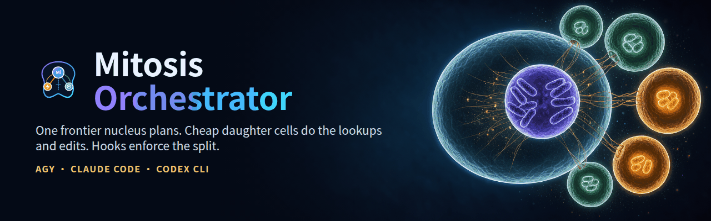
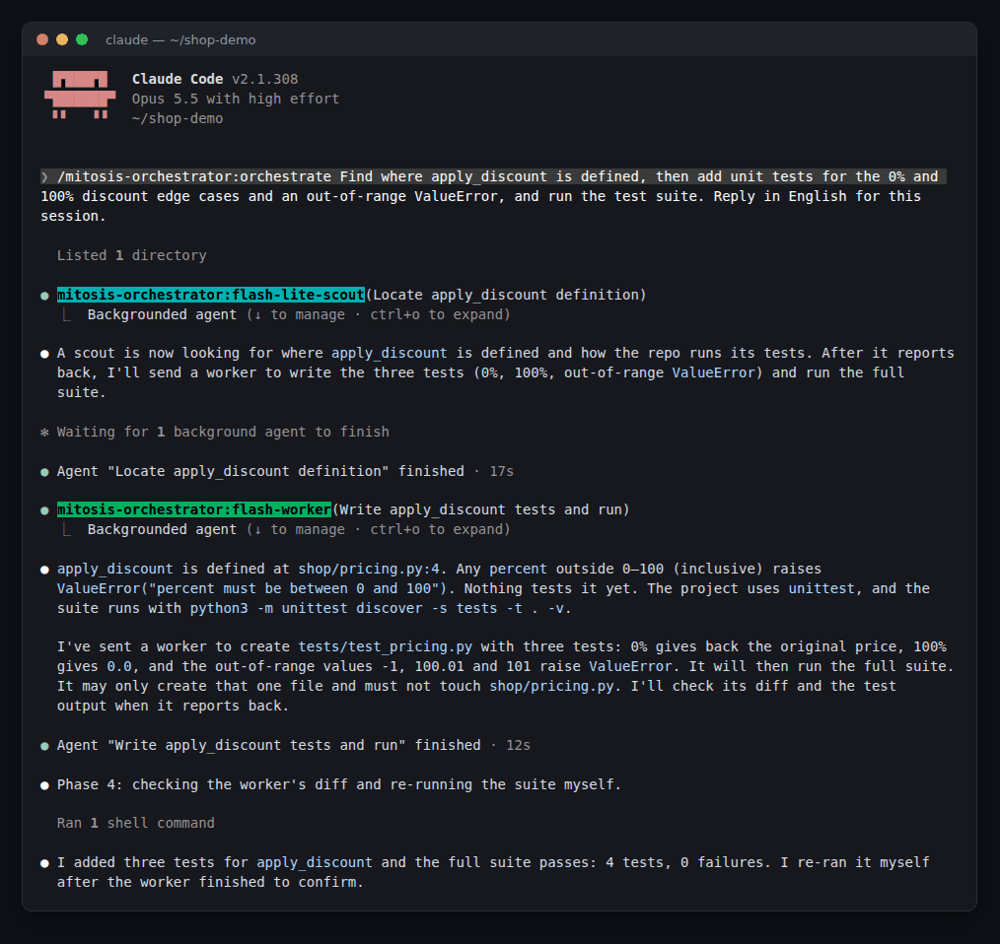
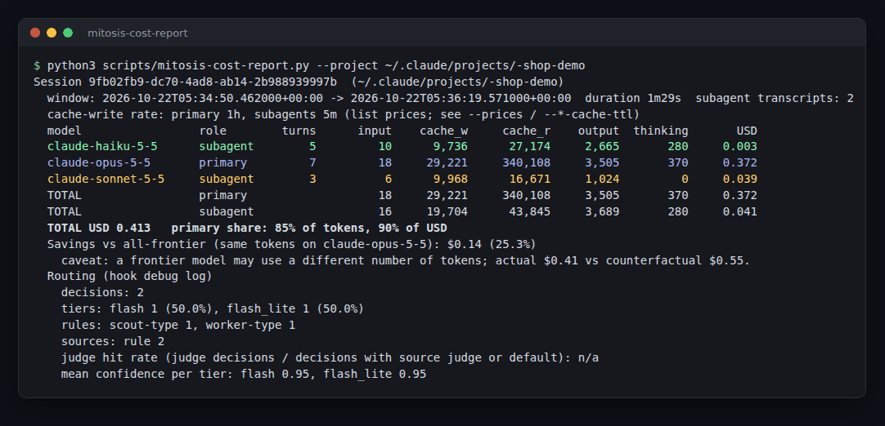
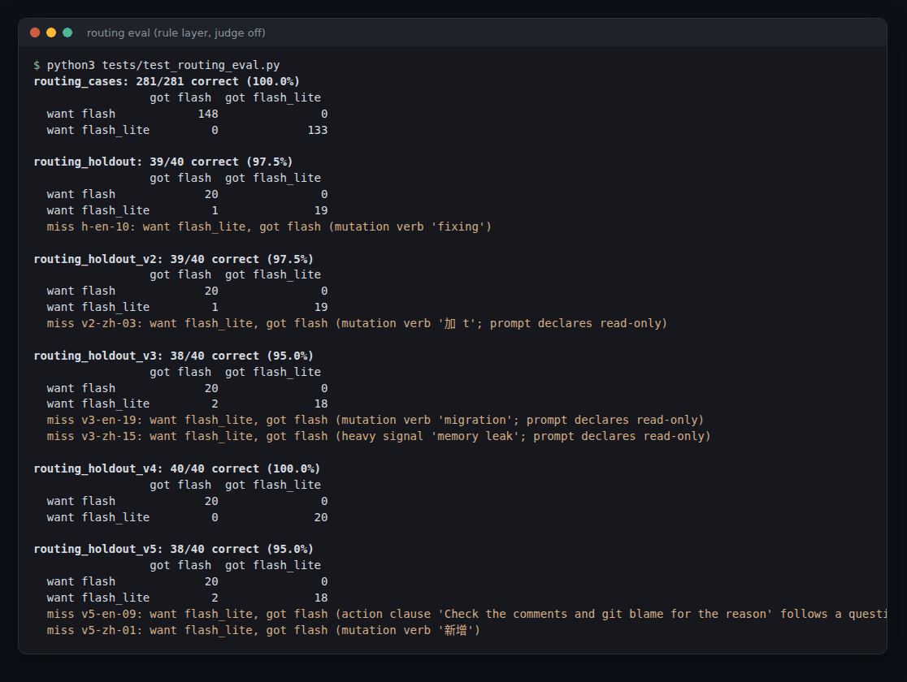
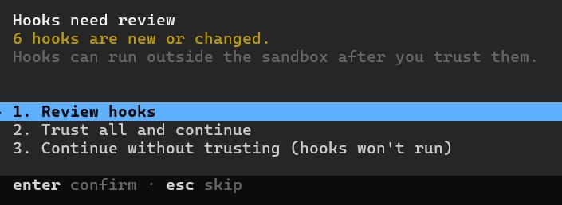

# Mitosis Orchestrator (`mitosis-orchestrator`)

[](https://github.com/ivanusto/mitosis-orchestrator/actions/workflows/ci.yml)

<p align="center">
  
</p>

<p align="center">
  <strong>Cross-Model Frontier Orchestrator with Unified 3-Platform Support</strong><br/>
  <em>Google Antigravity (<code>agy</code>) · Anthropic Claude Code · OpenAI Codex CLI</em><br/>
  <a href="./README.zh-TW.md">繁體中文說明 (README.zh-TW.md)</a> · <a href="./CHANGELOG.md">Changelog</a> · <a href="./SECURITY.md">Security</a> · <a href="./CONTRIBUTING.md">Contributing</a> · <a href="./rules/AGENTS.md">Orchestration Rules</a>
</p>

---

## Overview: Why Mitosis?

Inspired by biological **mitosis (cell division)**, **Mitosis Orchestrator** treats your chosen **frontier reasoning model** as the central **Master Nucleus (Primary Architect)**. Instead of filling the frontier model's context window with single-file searches, raw log reading, or repetitive edit-and-test cycles, Mitosis Orchestrator divides complex engineering work into specialized, context-bounded **daughter subagents**:

- **Master Nucleus (Primary Frontier Orchestrator)**: Retains full architectural context, designs API contracts, decomposes tasks, resolves cross-cutting invariants, and synthesizes final results.
- **Execution Daughter Cells (`flash-worker` · `worker`)**: Execute parallel multi-file analysis, documentation/web research, scoped code edits, and unit/integration test loops within an explicit file allowlist.
- **Reconnaissance Daughter Cells (`flash-lite-scout` · `explorer`)**: Perform high-fan-out, single-hop read-only lookups: locating symbols, running `grep`/`glob` searches, slicing `.log` or `transcript.jsonl` files, and inspecting single configs at minimal latency.

**What it is for.** Isolating the primary's context from noisy reads, and parallelism for work that really is parallel. Neither was measured in the comparison experiment below; the one cost comparison we ran found no saving (see [Is the plugin taking effect?](#is-the-plugin-taking-effect-240)).

## Screenshots

A real Claude Code session (Opus 5.5 primary) running `/orchestrate` on a small demo repo. The primary sends a `flash-lite-scout` to locate the function, then a `flash-worker` to write and run the tests, and re-checks the result itself:

<p align="center"></p>

`scripts/mitosis-cost-report.py` on a run of the same task: the scout ran on haiku, the worker on sonnet, and the primary still accounts for most of the cost (orchestration did not make this run cheaper; see the comparison below) (see [Choosing the Primary Model](./docs/cost.md#choosing-the-primary-model-on-claude-code-fable-51-vs-opus-55)):

<p align="center"></p>

The routing eval (`python3 tests/test_routing_eval.py`): no worker task reaches the read-only scout on any labelled set (see [Routing eval](#routing-eval)):

<p align="center"></p>

---


## Quick Start

Pick the CLI you use. Each block has the install commands and a one-line update command.

**Claude Code**

```bash
# Install
claude plugin marketplace add ivanusto/mitosis-orchestrator
claude plugin install mitosis-orchestrator@mitosis-orchestrator

# Update (then start a new session)
claude plugin marketplace update mitosis-orchestrator && claude plugin update mitosis-orchestrator@mitosis-orchestrator
```

**OpenAI Codex CLI**

```bash
# Install
git clone https://github.com/ivanusto/mitosis-orchestrator.git ~/mitosis-orchestrator
python3 ~/mitosis-orchestrator/scripts/setup-codex.py
codex plugin marketplace add ~/mitosis-orchestrator
codex plugin add mitosis-orchestrator@mitosis-orchestrator
# Then set hooks = true under [features] in ~/.codex/config.toml, open Codex and approve the plugin hooks in /hooks

# Update (re-adding refreshes the plugin snapshot). Every update needs a hook review: open Codex once and accept it.
# Until you do, `codex exec` shows `hook: ... Failed` and runs with no guard, even if the hooks file did not change
git -C ~/mitosis-orchestrator pull && python3 ~/mitosis-orchestrator/scripts/setup-codex.py && codex plugin add mitosis-orchestrator@mitosis-orchestrator
```

**Google Antigravity (`agy`)**

```bash
# Install (agy loads every directory under its plugin folder)
git clone https://github.com/ivanusto/mitosis-orchestrator.git ~/.gemini/config/plugins/mitosis-orchestrator

# Update
git -C ~/.gemini/config/plugins/mitosis-orchestrator pull
```

Check that it is active: a new session prints `[Mitosis Orchestrator Active] ...` and lists `/orchestrate`. Full options, requirements and what each installer changes are in [Installation & Setup](#installation--setup).

---

## Supported Frontier Primary Models

Mitosis Orchestrator is vendor-agnostic at the primary tier across all 3 platforms. It preserves the frontier model you select while filtering out lightweight models from acting as the primary orchestrator:

| Provider | Supported Primary Orchestrator Models | Auto-Filtered Small Tiers (Blocked as Primary) |
| :--- | :--- | :--- |
| **OpenAI** (Codex CLI / API) | **`gpt-6.1-sol`**, **`gpt-5.6-sol`**, `gpt-5.6-terra`, `gpt-6-astra`, `o1`, `o3`, `o4` | `gpt-5.6-luna`, `gpt-5.4-mini`, `o4-mini`, `o3-mini`, `gpt-4.1-mini` |
| **Anthropic** (Claude Code) | **`fable`** (Claude Fable 5.1), **`opus`** (Claude Opus 5.5), `sonnet` (Claude Sonnet 5.5) | `haiku` (Claude Haiku 5.5, `claude-haiku-*`) |
| **Google Gemini** (Antigravity `agy`) | `Gemini 4 Argon (High / Medium)`, `Gemini Pro`, `Gemini Ultra` | `gemini-3-flash`, `gemini-flash-lite`, `gemini-nano` |
| **xAI** | `Grok 3`, `Grok 4`, `grok-3`, `grok-4`, `grok-3-thinking` | `grok-3-mini`, `grok-3-mini-fast` |
| **DeepSeek** | `DeepSeek-R1`, `DeepSeek-V3`, `deepseek-reasoner`, `deepseek-chat` | `deepseek-lite` |
| **Alibaba Qwen** | `Qwen Max`, `Qwen Plus`, `Qwen 2.5 / 3`, `QwQ` (`qwq-32b`) | `qwen-lite`, `qwen-vl-lite` |

> [!NOTE]
> Boundary-aware regex filtering (`(?<![a-z0-9])(flash|lite|mini|nano|haiku|luna|spark)(?![a-z0-9])`) rejects lightweight variants across hyphen, space, or underscore naming conventions while never false-matching `gemini`.

---

## Choosing the Primary Model on Claude Code: Fable 5.1 vs Opus 5.5

- Recommended default: `opus` at `medium` effort. Scouts (`haiku`) and workers (`sonnet`) are pinned by the hook.
- Use `fable` for multi-hour autonomous runs, ambiguous specifications, cross-cutting refactors with subtle invariants and deep review.
- The primary is 70% to 85% of the spend in the measured sessions, so the primary model and its effort are the biggest cost lever.
- Prices, a worked example, the cost report and daughter-cell tuning: [docs/cost.md](./docs/cost.md).

---

## Installation & Setup

Requirements: Python 3.11+ (standard library only; `tomllib` is used by the Codex installer), `git`.

**Windows.** Hooks run through `cmd /c` on agy and try `python3`, then `python`, then `py -3`, so any normal install works. The Microsoft Store aliases in `%LOCALAPPDATA%\Microsoft\WindowsApps` exit 9009 without running anything; the chain moves past them. If a broken `python` shadows your real one, fix `PATH` or turn the aliases off in Settings > Apps > Advanced app settings > App execution aliases. **With no working Python the hooks exit 0 with no output:** the CLI keeps working (a failed hook blocks every tool on agy), but routing, model pinning and the guardrails are off, without any warning. Check with `python3 --version`, `python --version` or `py -3 --version`.

<!-- BEGIN GENERATED: compat -->
### Verified CLI versions

The CLI versions this plugin release was actually verified on. A newer CLI is unverified, not broken; `mitosis-doctor` shows it in an info row `<platform>.cli_verified` that never changes the exit code.

| Platform | Verified version | Verified on | Method |
| --- | --- | --- | --- |
| Claude Code | 2.1.318 | 2026-11-04 | headless run of advice, enforce and built-in pinning |
| Codex CLI | 0.166.0 | 2026-11-04 | installed plugin run after hook review |
| agy | 1.5.0 | 2026-11-04 | headless run of the edit budget and advice |

- agy: `agy plugin validate --strict` warns that hooks/hooks.json is not loaded. That file is for Claude Code; agy reads hooks.json at the plugin root.
<!-- END GENERATED: compat -->

### 1. Google Antigravity (`agy` 1.4+)

```bash
git clone https://github.com/ivanusto/mitosis-orchestrator.git ~/mitosis-orchestrator
agy plugin install ~/mitosis-orchestrator
agy plugin list            # mitosis-orchestrator (enabled, 2.6.0)
```

Alternatively clone straight into the global plugin directory; `agy` loads every directory under it automatically:

```bash
git clone https://github.com/ivanusto/mitosis-orchestrator.git ~/.gemini/config/plugins/mitosis-orchestrator
agy plugin validate ~/.gemini/config/plugins/mitosis-orchestrator --strict
```

> [!WARNING]
> If the predecessor plugin `argon-orchestrator` is still installed, uninstall it first (`agy plugin uninstall argon-orchestrator`). Both ship a skill named `orchestrate` and agents named `flash-worker` / `flash-lite-scout`, so they would collide and run two hook chains.

### 2. Anthropic Claude Code (2.1.292+)

The repository doubles as a single-plugin marketplace (`.claude-plugin/marketplace.json`), so it installs straight from GitHub:

```bash
claude plugin marketplace add ivanusto/mitosis-orchestrator
claude plugin install mitosis-orchestrator@mitosis-orchestrator
claude plugin list         # mitosis-orchestrator@mitosis-orchestrator  ✔ enabled
```

Updating later: `claude plugin marketplace update mitosis-orchestrator && claude plugin update mitosis-orchestrator@mitosis-orchestrator`.

For a local checkout, add the directory as the marketplace instead (`claude plugin marketplace add /path/to/mitosis-orchestrator`), or load it for one session only:

```bash
claude --plugin-dir /path/to/mitosis-orchestrator
```

What gets loaded: `hooks/hooks.json` (SessionStart / UserPromptSubmit / PreToolUse / PostToolUse / SubagentStop / Stop), the `/orchestrate` skill, and two subagents reachable through the `Agent` tool as `subagent_type: "mitosis-orchestrator:flash-lite-scout"` (haiku, effort `low`) and `subagent_type: "mitosis-orchestrator:flash-worker"` (sonnet, effort `medium`). Verify in a new session: the SessionStart banner `[Mitosis Orchestrator Active] Primary model is 'fable'.` appears and `/orchestrate` is listed.

### 3. OpenAI Codex CLI (0.134+; see the verified versions table above)

```bash
git clone https://github.com/ivanusto/mitosis-orchestrator.git ~/mitosis-orchestrator
python3 ~/mitosis-orchestrator/scripts/setup-codex.py
codex exec --profile mitosis-scout "Locate where parse_token is defined"
```

The installer is idempotent and performs, in order:

1. **Backs up** `$CODEX_HOME/config.toml` to `config.toml.bak` (`$CODEX_HOME` defaults to `~/.codex`).
2. **Copies** `rules/AGENTS.md` to `$CODEX_HOME/AGENTS.md`.
3. **Installs** native agent role files into `$CODEX_HOME/agents/`: `explorer.toml` & `flash-lite-scout.toml` (`gpt-5.6-luna`, `low` effort) and `worker.toml` & `flash-worker.toml` (`gpt-5.6-terra`, `medium` effort). Roles are selectable by the primary agent through `spawn_agent(agent_type=...)`; the `flash-*` role files exist only after this installer has run.
4. **Installs** profile files `mitosis-scout.config.toml` and `mitosis-worker.config.toml` into `$CODEX_HOME/` (Codex 0.134+ reads `--profile <name>` from `$CODEX_HOME/<name>.config.toml`; the legacy `[profiles.*]` table is no longer honoured).
5. **Configures** `[mcp_servers.mitosis]` in `config.toml` with the running interpreter and the absolute path to `scripts/mitosis-mcp-server.py`.
6. **Validates** every TOML file and verifies all mounted files exist.

The MCP server runs scouts with `--sandbox read-only` and workers with `--sandbox workspace-write`. Set `MITOSIS_CODEX_YOLO=1` only if you deliberately want `--dangerously-bypass-approvals-and-sandbox`.

Since 1.7.0 the plugin hook rewrites `spawn_agent` calls to the built-in `explorer` (scout) and `worker` roles, because Codex 0.163 rejects an unknown `agent_type` (`unknown agent_type '...'`) and the `flash-*` roles do not exist on plugin-only installs. Models and efforts come from `gpt-5.6-luna` / `gpt-5.6-terra` with `low` / `medium`; override them with `CODEX_MITOSIS_SCOUT_MODEL`, `CODEX_MITOSIS_WORKER_MODEL`, `CODEX_MITOSIS_SCOUT_EFFORT` and `CODEX_MITOSIS_WORKER_EFFORT`. The values are validated (the model is spliced into a `codex exec` command) and there is no `AGY_` form. `setup-codex.py` renders the role and profile TOMLs with the effective values and passes them to the MCP server through its `env` table.

### Plugin hooks (Codex 0.128+)

Codex can also load the hooks as a plugin:

```bash
codex plugin marketplace add <path-to-repo>
codex plugin add mitosis-orchestrator@mitosis-orchestrator
```

Enable the hooks feature in `config.toml`, then open Codex and approve the plugin hooks in `/hooks`; a hook that is not approved does not run and the session carries on with no guard. **Every plugin update requires a review on Codex**, even when the hooks file did not change, because Codex hashes the whole plugin directory (excluding `__pycache__`, `.venv`, `*.pyc` and `*.egg-info`). After updating: run `python3 scripts/mitosis-doctor.py` (it reports `trust.bundle` FAIL until you accept, which is correct), open Codex and accept the review, run doctor again (OK), and check that `hook:` lines show `Completed`. `setup-codex.py` is still needed for the MCP server, agent roles and profiles.

<p align="center"><br/><em>Codex shows this after every plugin update. Until you trust the hooks, they do not run and the guards are off.</em></p>

Codex 0.163 (multi-agent v2) names its agent tools `collaboration<tool>` in hook payloads (`collaborationspawn_agent`, `collaborationfollowup_task`, `collaborationsend_message`) and passes their `message` as an encrypted token. Since 1.8.0 the hook strips the namespace, registers each spawn under its `task_name` (the address `followup_task` / `send_message` use in `target`), and, because the text cannot be read, refuses follow-ups to a scout instead of checking them. Since 2.0 a child's own hooks (which carry an `agent_id`, not the `task_name`) are bound to its record through the first line of the child rollout (`session_meta.agent_path`), else through the only unbound record of the same role; `SubagentStop` updates that record (stops, `last_turn_id`, `report_ok`). Since 2.1 it also sends a bound scout/worker back once (`{"decision":"block"}`; Codex re-runs the child, and the second `SubagentStop` carries `stop_hook_active: true`) when its final message is not the four-header report, which happens when the primary dictates its own headings in the hidden `spawn_agent` message. Verified on Codex 0.163: a `SubagentStop` block makes the child answer again, and the parent receives the corrected report. The agent definitions say the four headers win over the task message, and the SessionStart notice tells the primary not to dictate headings. Set `CODEX_MITOSIS_DEBUG=1` in the environment Codex runs in to log every hook call (raw tool name, input keys, state) to `$TMPDIR/mitosis-orchestrator/<session>/mitosis_orchestrator_debug.log`.

---

## Bundled Components & Guardrails

### 1. Lifecycle Enforcement Hooks ([`hooks.json`](./hooks.json) · [`hooks/hooks.json`](./hooks/hooks.json) · [`scripts/enforce-orchestrator.py`](./scripts/enforce-orchestrator.py))
Zero-dependency Python 3.8+ standard library hook engine (entry script plus the [`scripts/mitosis_hook/`](./scripts/mitosis_hook) package) on every turn (~30 ms per call). Model pinning and the scout read-only layer are enforced; delegation of the primary's own edits and tests is advice by default (`*_MITOSIS_FASTPATH_MODE`). On Claude Code the `PreToolUse` matcher is limited to the tools the engine actually inspects (`Agent`, `Task`, `Bash`, `Read`, `NotebookRead`, `Write`, `Edit`, `NotebookEdit`, `SendMessage`), so `Grep` / `Glob` / `WebFetch` / MCP calls no longer pay the hook start-up cost:

| Hook Event | Guardrail / Behavior |
| :--- | :--- |
| `SessionStart` | Checks settings, **warns** if the configured primary model is not a supported frontier model, and injects the Mitosis routing policy. Rewrites settings only when `*_MITOSIS_PIN_SETTINGS=1` is enabled. |
| `PreInvocation` (agy) · `UserPromptSubmit` (Claude Code / Codex) | Verifies the live session model on every turn; warns once per invocation if switched to a non-frontier model. Resets per-turn tracking (`turn_edited_files`, `consecutive_failures`; on agy only when `invocationNum` returns to 0). |
| `PreToolUse` · `invoke_subagent` (agy) | Classifies every spawned subagent into `flash` or `flash_lite` based on `TypeName`, `Workspace`, and `Prompt` (on agy the short `Role` label is not read, since a label such as "Add Scout" would look like a mutation). agy 1.4.6 sends one flat call per subagent (`Prompt`, `Role`, `TypeName`, `Model`, `Workspace`) instead of a `Subagents` list; both forms are handled, and the hook overwrites only the changed top-level keys. Strong signals (testing, debugging, call-graph tracing, mutation verbs) always override lookup keywords. Automatically upgrades `flash-lite-scout` to `flash-worker` if given a mutation task, and appends the `REPORT FORMAT` block to prompts that lack one. |
| `PreToolUse` · `Agent` (Claude Code) | Pins **only** this plugin's own agent types (`flash-worker`, `flash-lite-scout`, with or without the `mitosis-orchestrator:` prefix) and untyped `Agent` calls that use `model: inherit`. Pins `effort` too (scout `low`, worker `medium`; caller values honoured; `CLAUDE_MITOSIS_PIN_EFFORT=0` disables) and appends the four-header `REPORT FORMAT` block to prompts that lack one (`CLAUDE_MITOSIS_APPEND_REPORT_FORMAT=0` disables). Other plugins' agents, built-in types (`Explore`, `Plan`, `general-purpose`, …), and untyped calls with an explicit model are passed through untouched. `CLAUDE_MITOSIS_PIN_SUBAGENTS=0` disables pinning entirely. Opt-in `CLAUDE_MITOSIS_PIN_BUILTINS=1` (off by default) also pins the built-in `Explore` (scout model and effort) and routes `general-purpose` like an untyped call; an explicit model is still honoured and `Plan` and the rest stay untouched. See the env table for the limits. |
| `PreToolUse` · `spawn_agent` / `codex exec` (Codex) | Pins subagents to `gpt-5.6-luna` (scout) or `gpt-5.6-terra` (worker) by prompt classification. When Codex hides the message from hooks (0.163 sends an encrypted token), the requested `agent_type` decides, the message is left untouched, and a call without a role is pinned to `worker`. |
| `PreToolUse` · `send_message` (agy / Codex) · `SendMessage` (Claude Code) · `followup_task` (Codex) | Blocks code-editing or multi-step (>3 numbered rules) follow-up instructions sent to a scout; a Codex `followup_task` is also routed like a new task. Claude Code recipients are recognised by the agent id that `PostToolUse` / `SubagentStop` pair with the spawn, Codex recipients by the `task_name` registered at `spawn_agent`. Codex follow-up text that hooks cannot read is refused for scouts: spawn a new explorer or a worker instead. |
| `PreToolUse` · scout's own tools (Claude Code / Codex) | A `flash-lite-scout` or Codex `explorer` cannot use `Write` / `Edit` / `apply_patch`, whatever its prompt says, and its shell commands must pass a read-only allowlist. The check reads command text and denies what it cannot read for certain; it is not a sandbox ([SECURITY.md](./SECURITY.md)). |
| `PreToolUse` · `run_workflow` | Blocks workflow scripts whose `agent(...)` calls omit model specification. |
| `PreToolUse` · `define_subagent` | Forces `enable_subagent_tools=false` to prevent recursive nested subagent spawning. |
| `PreToolUse` · **Context Hygiene** | Blocks the primary agent from directly reading raw `.log` or `transcript.jsonl` files, keeping noisy logs out of the primary context window by delegating log slicing to reconnaissance scouts. |
| `PreToolUse` · **Fast-Path Budget** | Caps direct workspace file mutations by the primary agent at `3` distinct files per turn (configurable via `*_MITOSIS_MAX_DIRECT_EDITS`) and flags direct workspace edit + test-runner loops on the primary agent. Mode `*_MITOSIS_FASTPATH_MODE`: `advise` (default) never blocks and adds one short advice note per kind per turn; `enforce` denies as in earlier versions; `off` disables the budget. On agy the budget is per user turn (it resets when `invocationNum` returns to 0). Test-runner detection ignores quoted text, heredoc bodies and `grep`/`git`/`cat`-style commands. |
| `PreToolUse` · **Circuit Breaker** | After `2` commands in a row fail in one user turn, `*_MITOSIS_CIRCUIT_BREAKER_MODE` decides: `advise` (default) adds one note on agy and never blocks, `enforce` denies `run_command`, `Bash` and subagent spawns until the next turn, `off` disables. On agy the exit code is read from the transcript at the next model call, because PostToolUse carries none. A read-only command that exits 0 or 1 (`grep` with no match) neither counts nor clears the streak. Hooks do not run inside agy subagents, so a worker's own test loop is not counted. **On Claude Code and Codex the counter has never counted a real failure**, since their payloads have no field it reads, so the breaker does nothing there. |
| `PreToolUse` · **Workspace Guard** | Opt-in (`*_MITOSIS_AUTO_ALLOW=1`): auto-approves file and command tools that stay inside the workspace on Claude Code and agy (on Codex the guard only denies, because Codex rejects an allow without `updatedInput`), while prompting (`ask`; `deny` on Codex, which has no `ask`) for outside paths, privilege escalation, root deletes, force pushes, or shell-piped downloads. When disabled it gives no verdict: on Claude Code the hook returns `{}`, so your normal permission rules and prompts apply (1.5.0 and earlier returned `allow`, which skipped them). |
| `PostToolUse` · `PostToolUseFailure` (Claude Code) | Pairs spawned subagents with platform metadata and updates failure streaks. Captures `SubagentHandback` reports (auto mode). Failed Bash arrives as `PostToolUseFailure` and is counted, observe only. |
| `SubagentStop` / `Stop` | When the turn is idle and branch worktrees remain alive, reminds the primary agent once per set of live workers to merge/discard changes and clean them up. On Claude Code and Codex (bound agents only; `CODEX_MITOSIS_ENFORCE_REPORT=0` disables there), `SubagentStop` also checks that a `flash-lite-scout` / `flash-worker` ended with the four-header report and, once per agent, sends it back to rewrite its final message (`CLAUDE_MITOSIS_ENFORCE_REPORT=0` disables). |

#### Failure escalation (2.3)

- **Trigger.** A mitosis scout reports `STATUS: FAILED` or `BLOCKED`. Claude Code detects it on `SubagentStop` (background `Agent` calls deliver the report only there) or in a synchronous `PostToolUse` result; Codex on `SubagentStop` of a bound explorer; agy (2.3.1) on the primary's next pre-invocation or `invoke_subagent` call, by reading the reports in `<artifactDirectoryPath>/.system_generated/messages/`. The first scan of a conversation only marks old reports as seen. The same pre-invocation also tells the primary once per subagent when a report breaks the four-header contract.
- **agy note.** The bundled agents use `inheritCustomizations: false`, so plugin hooks do not run inside them; only the primary-side scan works (see the verified versions table above).
- **Effect.** The next scout-routed dispatch runs on the worker (rule `escalation`), once, within 3 dispatches or 30 minutes. An escalated spawn never escalates again. Untyped calls keep no `subagent_type` and only get the model.
- **Opt-in.** `*_MITOSIS_ESCALATE_PRIMARY=1` (Claude Code only) also sends the next dispatch after a failed worker to the primary model. `*_MITOSIS_ESCALATE=0` turns escalation off.
- **Headless check.** A scout told to read a missing file reported `BLOCKED`, and the same scout-typed re-dispatch ran as `mitosis-orchestrator:flash-worker` on sonnet (0.25 USD session).
- Since 2.3 background `Agent` launches (`{"isAsync": true, "agentId": ...}`) are also registered, so the `SendMessage` scout guard sees them.
- Since 2.5.0 a scout's declared `BLOCKED` or `FAILED` is trusted without a log URI once no retry can come (before, it failed validation and, on interactive Claude Code's background path, no escalation started). `CLAUDE_MITOSIS_ENFORCE_REPORT=0` no longer turns off background escalation, untyped pinned agents escalate, a fenced report arms, and a quoted `- STATUS: FAILED` line inside a `COMPLETED` report does not. Workers still need the URI.

### 2. Bounded 4-Header Subagent Report Contract
All reconnaissance scouts and execution workers return a strict, token-efficient 4-header report (≤ 1,600 characters, up to 10 compact bullet lines under `NOTES:`, and, for workers, a mandatory `file://.../*.log` scratch log URI whenever `STATUS` is `BLOCKED` or `FAILED`; a scout is read-only and cannot write a log, so its declared `BLOCKED` or `FAILED` is accepted without one):

<!-- BEGIN GENERATED: report-format -->
```markdown
STATUS: COMPLETED | BLOCKED | FAILED
FILES_CHANGED: <comma-separated paths or NONE>
VERIFICATION: <one sentence stating the command run and its exit result>
NOTES: <one sentence of findings or up to 10 bullets; when BLOCKED or FAILED, include a file:// log URI>
```
<!-- END GENERATED: report-format -->

### 3. 4-Phase `/orchestrate` Skill ([`skills/orchestrate/SKILL.md`](./skills/orchestrate/SKILL.md))
Provides the structured `/orchestrate` workflow:
1. **Phase 1: Reconnaissance (Scout / Explorer Fan-Out)**: Parallel read-only scouts gather file paths, symbols, and config layouts.
2. **Phase 2: Architecture & Decomposition (Primary Frontier Agent)**: Synthesize recon findings, design interfaces, and partition work units.
3. **Phase 3: Scoped Execution & Testing (Workers)**: Parallel workers implement changes within explicit file allowlists and run verification commands.
4. **Phase 4: Synthesis & Branch Cleanup (Primary Frontier Agent)**: Review diffs, verify integration, and terminate branch worktrees.

---

## Unified 3-Platform Context Routing Matrix (v1.5.0)

| Tier | Google Antigravity (`agy`) | Anthropic Claude Code | OpenAI Codex CLI | Role & Responsibilities |
| :--- | :--- | :--- | :--- | :--- |
| **Primary Master Nucleus** | `Gemini 4 Argon (High/Medium)` / Frontier | `fable` / `opus` / `sonnet` | **`gpt-6.1-sol`** / `gpt-5.6-sol` / `gpt-6-astra` / `o3` | System architecture, multi-step planning, cross-cutting refactors, security/concurrency review, user clarification, and final synthesis. |
| **Execution Worker** | `flash` via [`flash-worker`](./agents/flash-worker/agent.md) | `sonnet` via [`mitosis-orchestrator:flash-worker`](./claude-agents/flash-worker.md) | **`gpt-5.6-terra`** via [`worker`](./codex-agents/worker.toml) / [`flash-worker`](./codex-agents/flash-worker.toml) or `--profile mitosis-worker` | Multi-file codebase exploration, call-graph tracing, web/documentation research, writing & running tests, and scoped code edits within an explicit allowlist (`workspace-write`). |
| **Reconnaissance Scout** | `flash_lite` via [`flash-lite-scout`](./agents/flash-lite-scout/agent.md) | `haiku` via [`mitosis-orchestrator:flash-lite-scout`](./claude-agents/flash-lite-scout.md) | **`gpt-5.6-luna`** via [`explorer`](./codex-agents/explorer.toml) / [`flash-lite-scout`](./codex-agents/flash-lite-scout.toml) or `--profile mitosis-scout` | Single-hop read-only lookups: file/symbol location, `grep`/`glob` searches, `git status`/`git log`, log tail slicing, and single-file inspection (`read-only`). |


### Confidence-graded routing and the optional judge (v1.5.0)

Every routing decision is a `Decision`: `tier`, `effort`, `confidence`, `source` (`rule`, `judge` or `default`), `rule` and `reason`. With `*_MITOSIS_DEBUG=1` each one is written to the debug log under `decisions`, so you can see which rule fired and how sure it was.

```
keyword rules ──► confidence ≥ 0.9 ──────────────────────────────► use the rule
      │
      └─ confidence < 0.9 and MITOSIS_JUDGE_URL set ──► judge ──► sure  ──► use the judge
                                                          └────► unsure / error ──► flash (cannot fail the task)
```

- **Rule confidence.** Explicit types, workspace and explicit models score 0.95 and are never judged. Mutation verbs score 0.95, heavy signals 0.9, lite signals 0.85, and the prompt-length fallbacks 0.5.
- **Read-only declarations.** A prompt that says it is read-only (`read-only`, `do not modify anything`, `唯讀`) drops mutation and heavy hits to 0.6, because in such prompts those words are usually the topic ("review the fixes", "plan the migration").
- **Wider negation.** `Do NOT git fetch/pull or modify` and `never delete or rename` now count as prohibitions; `don't X and fix Y` still asks for a fix.
- **The judge is off by default.** Setting `MITOSIS_JUDGE_URL` turns it on. It speaks the Jev `choice` request format, so TypeSafe Jev, a self-hosted Jev-compatible gateway and Ollaya are interchangeable. A judge may veto a scout's mutation upgrade, but never overrides explicit types, workspace modes or models. Without a URL, routing is identical to v1.4.1 apart from the wider negation.
- **Privacy.** The judge receives the first 2000 characters of the prompt after secrets, e-mail and IP addresses and home directories are masked ([`scripts/mitosis_judge.py`](./scripts/mitosis_judge.py)). Use a local gateway if prompts must not leave the machine.
- **When it matters.** On Claude Code the primary nearly always picks a typed agent, so the judge mostly sees untyped calls and Codex `spawn_agent` prompts. In a 66-prompt sample of real sessions, typed calls never reached it.

### Routing eval

Rule layer only, judge off. Cells read correct/40, cost errors, dangerous ("dangerous" means a worker task routed to the read-only scout).

| Set | Role | v1.8.1 | v2.0.0 | v2.1.0 | v2.2.0 | v2.3.0 |
| :--- | :--- | :--- | :--- | :--- | :--- | :--- |
| routing_cases (183 -> 281 -> 361 -> 562 -> 855) | training | 183/183, 0 dangerous | 281/281, 0 dangerous | 361/361, 0 dangerous | 562/562, 0 dangerous | 855/855, 0 dangerous |
| 2.1 hand-written counterexamples (80, inside routing_cases) | training in 2.1.0 | | 44/80, 15, 21 | 80/80, 0, 0 | 80/80, 0, 0 | 80/80, 0, 0 |
| 2.2 hand-written cases and review probes (201, inside routing_cases) | training in 2.2.0 | | | 130/201, 27, 44 | 201/201, 0, 0 | 201/201, 0, 0 |
| 2.3 hand-written cases and review probes (293, inside routing_cases) | training in 2.3.0 | | | | 205/293, 21, 67 | 293/293, 0, 0 |
| holdout v1 (40) | tuned | 39/40, 1, 0 | 39/40, 1, 0 | 39/40, 1, 0 | 39/40, 1, 0 | 39/40, 1, 0 |
| holdout v2 (40) | tuned | 39/40, 1, 0 | 39/40, 1, 0 | 39/40, 1, 0 | 40/40, 0, 0 | 40/40, 0, 0 |
| holdout v3 (40) | tuned | 36/40, 4, 0 | 38/40, 2, 0 | 38/40, 2, 0 | 38/40, 2, 0 | 38/40, 2, 0 |
| holdout v4 (40) | tuned in 2.0.0 | 33/40, 7, 0 | 40/40, 0, 0 | 40/40, 0, 0 | 40/40, 0, 0 | 40/40, 0, 0 |
| holdout v5 (40) | sealed blind, scored once; tuned in 2.0.0 | 29/40, 10, 1 | first contact 37/40, 2, 1; final 38/40, 2, 0 | 39/40, 1, 0 | 39/40, 1, 0 | 39/40, 1, 0 |
| holdout v6 (40) | sealed blind, scored once per version; used to pick the 2.2 gaps | | 29/40, 8, 3 | 32/40, 8, 0 | 35/40, 5, 0 | 35/40, 5, 0 |
| holdout v7 (40) | sealed blind, scored once per version; two misses fixed afterwards | | | 31/40, 7, 2 | first contact 34/40, 4, 2; final 36/40, 4, 0 | 36/40, 4, 0 |
| holdout v8 (40) | sealed blind, scored once per version; one miss fixed afterwards | | | | 35/40, 4, 1 | first contact 35/40, 4, 1; final 37/40, 3, 0 |
| holdout v9 (80) | sealed blind, scored once per version; no longer blind | | | | | 74/80, 6, 0; 2.4.0 candidate 74/80, 6, 0 |

v5 was written without access to the scripts or earlier sets, sealed by sha256 (`160c44e16043fdfee4534dd5af8f4466a85ad2ce9f9ee10e4d2e74cac9cf42ad`) and scored once against the 2.0 candidate rules. The one dangerous miss (`v5-en-19`, a polite request with a gerund) was already misrouted by 1.8.1; the `polite-request` rule was then written from new cases only, so v5 is no longer blind and the next tuning round needs a v6 first. 2.0.0 also closes three dangerous misroutes that 1.8.1 had (question followed by an imperative, shell mutations in pipelines, polite gerund requests); those rules are not judgeable. Known limitation: the rule layer is still lexical, with no embedding stage.

v6 (sha256 `69d3cec3e684453d510898557d13d7eb0abaad61aa09599c60bb688ef331daf9`) was written blind by a subagent, sealed in commit 1c5d524 and scored once on 2026-10-22 in separate processes: 2.0.0 29/40, 8 cost, 3 dangerous; 2.1.0 32/40, 8 cost, 0 dangerous. Four of the cost errors are lookups typed `flash-worker`, which always routes to the worker. It was not tuned on afterwards.

v7 (sha256 `8b6bf9167d44663ce7745ec5f79102cbdb00e4e3ed7e3afb2a6d438d2743273c`) was written blind by a subagent, sealed in commit 7dffeb0 and scored once on 2026-10-22 in separate processes: 2.1.0 31/40, 7 cost, 2 dangerous; the 2.2 candidate (c648116) 34/40, 4 cost, 2 dangerous. The two dangerous misses (scout-typed prompts that open with an action or run a writing command) were then fixed with general rules from new hand-written cases (416f754): 36/40, 4 cost, 0 dangerous. v7 is therefore no longer blind. The remaining cost errors include one lookup typed `flash-worker` that is kept on the worker and a read-only question that mentions fix/pytest.

v8 (sha256 `f9824228436592160454357236a858da84cc9a4289879d159695ce5786470d51`) was written blind by a subagent, sealed in commit 27914e3 and scored once on 2026-10-22 in separate processes: 2.2.0 35/40, 4 cost, 1 dangerous; the 2.3 candidate (e237483) 35/40, 4 cost, 1 dangerous, the same five misses. The dangerous miss (a scout-typed comparison of third-party frameworks' current docs, which needs the web) was then fixed with general rules from new hand-written cases (d0b2624): 37/40, 3 cost, 0 dangerous. v8 is therefore no longer blind. The 2.3 rule work did not move the blind score: both versions missed the same five prompts. The 2.3 gains are on 175 private review probes in seven batches (on the 293 new cases 2.2.0 scored 205/293 with 67 dangerous) that each exposed a new action shape under the type-first default, which is why 2.3 inverted the default for scout-typed calls. The remaining v8 cost errors are two lookups typed `flash-worker` that stay on the worker and one simplified-Chinese question.

v9 (80 prompts, sealed in commit 4ec78be) was scored once per version in separate processes: 2.3.0 74/80, 6 cost, 0 dangerous; the 2.4.0 candidate 74/80, 6 cost, 0 dangerous, the same six misses. The 2.4 routing fixes did not move the blind score. v9 has now been scored and is no longer blind (`tests/test_routing_eval.py` keeps it as a regression test), so the next routing round writes v10 first.

**2.1 routing additions.**
- Run phrases that only ask which command runs something are topics; a leftover "and run it" still upgrades.
- A `flash-lite-scout` typed call is upgraded to the worker when it needs web access (`scout-web`, 0.9), ends with an action after a question (`trailing-imperative`) or still asks for a run (`run-directive`, 0.9).
- A scout-typed call that declares read-only with its last word keeps the scout (`scout-read-only`, 0.7, judgeable).
- New soft-request frames: "would it be possible to", "appreciate it if you" + past tense, "it would be great if you" + verb.
- Questions without "?" (auxiliary inversion, "I wonder", "not sure", "curious", 不確定 / 不知道 / 想知道 / 好奇) arm the trailing-imperative check.
- New Chinese verbs (弄成, 弄好, 搞定, 拉到, 換掉, 改掉, 調成, 調大, 調小) and lookups (弄清楚, 搞清楚, 釐清).
- Known gaps (closed in 2.2): lookups typed `flash-worker`, scout prompts over 600 characters skipping the trailing-imperative check, and Chinese verbs outside the list.

**2.2 routing additions.**
- `worker-lookup`: a short, plain read-only lookup typed `flash-worker` goes to the scout with the scout type (0.7, judgeable). `*_MITOSIS_WORKER_DOWNGRADE=0` turns it off. Any edit, run, non-read-only command, web need, broad research or non-read clause keeps the worker.
- Long scout briefs (over 600 characters) check the final paragraph for an action clause.
- `scout-imperative` (0.85): a scout-typed prompt whose first clause opens with a non-read verb is upgraded, in English and Chinese.
- `run-directive` also covers run/跑/執行 + a command the scout cannot run; "you may run", "feel free to run" and 可以執行 are permission, not a request.
- Chinese 把/將 disposal constructions, transitive X掉 and resultative complements count as edits; 被 passives, 要不要/是否 frames and why/where questions are topics.
- Polite frames (請/幫我) take any non-read verb.
- Read-only follow-ups: 只要讀, 只需確認, 不必重現, "paste the output".
- "from the web process" and local CHANGELOG reads no longer count as web needs.
- Known gaps (closed in 2.3): the rule layer is still lexical, so unlisted English verbs with a plain lowercase object and Chinese action verbs outside the lexicon (when the clause does not use 把/將 or a resultative complement) were missed.

**2.3 routing additions.**
- `scout-unproven` (0.6, judgeable): a scout-typed call keeps the scout only with positive read-only evidence, otherwise it goes to the worker. Evidence: a question, a read verb (including compare, review, summarize), a lookup signal or read-only command, a read-only declaration, a verbless noun-phrase lookup or a terse "<identifier> in <file>". Modal and desire statements and elliptical assignments are not evidence.
- Actions are found in any sentence and after a topic separator ("For api/routes.py: alphabetize ...").
- Unlisted English verbs with a plain object and "<verb> out" phrasal verbs count as actions.
- Chinese code-edit verbs, 替/給/幫 + verb, and verb + resultative + code token count as actions.
- Runner-state questions ("Does mypy pass on main?", 目前有沒有過) need a run; config, marker, fixture and history questions that name pytest or fix stay lookups.
- 不用/別 + a read or run verb is a restriction, not a request.
- Cleft and whether frames are handled, simplified Chinese included.
- Third-party docs, release notes and references need the web.
- ALL-CAPS identifiers and file names are never verbs.
- Known gaps: the rule layer is still lexical, with no embedding stage; the v8 writer's errors were in categories none of the 2.3 probes covered, so expect new shapes; worker-typed lookups stay on the worker unless short and plain; the failure escalation above is the safety net.

Earlier rounds (1.6.0 to 1.7.0), cells read correct/40, dangerous:

| Set | Role in 1.7.0 | v1.6.0 | v1.7.0 |
| :--- | :--- | :--- | :--- |
| routing_cases (120 -> 183) | training | 119/120, 0 dangerous | 183/183, 0 dangerous |
| holdout v1 (40) | tuned in 1.5.1 and 1.7.0 | 32/40, 0 | 39/40, 0 |
| holdout v2 (40) | blind baseline, then training | 25/40, 4 | 39/40, 0 |
| holdout v3 (40) | blind first contact after the first tuning round, then training | 25/40, 9 | 29/40, 6 at first contact; 36/40, 0 after |
| holdout v4 (40) | blind, scored once, not tuned | 25/40, 8 | 33/40, 0 |

The 1.5.1 "zero dangerous" result did not generalise: three fresh blind sets each had 4 to 9 dangerous misroutes on v1.6.0. The first 1.7.0 round fitted the training sets but barely moved the blind score. All six remaining dangerous v3 misses came from the short-prompt fallback, so 1.7.0 changed it to send prompts with no lookup signal to the worker (a cost error instead of a failed scout run), and added run, CLI and docs-lookup signals. The 7 remaining v4 errors were lookups sent to the worker (cost, not failure): read-only questions that name debug, migration or build words. 2.0.0 fixes that class in the rule layer (see the table above).

---

## What changed in 2.6.0

**After updating.** The primary is no longer blocked for editing more than 3 files in a turn or for running tests after an edit: it gets one piece of advice per kind per turn. Set `*_MITOSIS_FASTPATH_MODE=enforce` to get the denials back. On Codex, open Codex once and accept the hook review. On Claude Code, start a new session. Details: [CHANGELOG.md](./CHANGELOG.md).

---

## What changed in 2.5.0

**After updating.** On Codex, open Codex once and accept the hook review; doctor shows `trust.bundle` FAIL until you do. On Claude Code, start a new session. Details: [CHANGELOG.md](./CHANGELOG.md).

**Scout command check (security).** A white-box review found 28 cases in 7 causes where the check allowed a command that writes to the repository or can lead to running a program: `git config --get --no-get core.x val` (writes config on git before 2.46; `core.fsmonitor` then runs a program on `git status`), `git branch --list --no-list`, `git tag --format --list`, gpg through `--show-signature`, `%G` and `%(signature`, `--diff-merges=remerge`, `file -z`, ugrep `---` and a glob in the `git -C` slot. A Codex scout started through the MCP server has an OS sandbox (`--sandbox read-only`); a Claude Code scout has none. See [SECURITY.md](./SECURITY.md).

**Codex hook trust.** Every plugin update needs a review (Codex hashes the whole plugin directory). Doctor now decides this offline, so a healthy Codex can exit 0.

**Failure escalation.** A scout's declared `BLOCKED` or `FAILED` is trusted without a log URI (it cannot write one) once no retry can come.

**Correction.** `write_stdin` cannot be fixed by a matcher change (Codex does not send it to hooks); fish does not arise.

**Overhead experiment.** On a short lookup task `/orchestrate` cost +19.3% against off (not completely separated) and a loaded plugin 0.0%; the static prefix explains about a quarter of the former. No savings claim.

---

## Is the plugin taking effect? (2.4.0)

2.4.0 is about whether the plugin takes effect, not about routing accuracy.

**Measured use.** One machine, 2026-10-23 to 2026-11-02, interactive Claude Code, `mitosis-cost-report.py --fleet`: 40 sessions, 5,799 primary tool calls, 27 `Agent` calls (0.5%); Bash was 77% of tool calls. The primary cost about 492 USD and subagents about 11.4 USD (2.3%). Of the subagent spend, 23.8% was unpinned (2 `Explore` calls, 2.71 USD), and no subagent ran on haiku. Limit: one user, one machine, 11 days, list prices.

**Doctor.** `python3 scripts/mitosis-doctor.py` checks each installed platform and prints OK, WARN, FAIL, UNKNOWN or SKIP. It runs each install's real hook command chain with per-platform payloads (including Chinese text under a cp950 console) and reads the heartbeat. Anything it cannot determine is UNKNOWN, never OK. Exit 0 means all OK or SKIP, 1 any WARN or UNKNOWN, 2 any FAIL. Since 2.5.0 doctor recomputes the Codex hook trust hashes from local files (rows `trust.<event>` for the declaration hash and `trust.bundle` for the content hash; the old `trust_hash` UNKNOWN row is gone). A match is conclusive. A mismatch is a conclusive FAIL only for Codex versions whose hashing was checked against source (0.166, on POSIX) and UNKNOWN otherwise. So a healthy Codex install can now exit 0, and agy still exits 1 because its child model cannot be checked. Right after an update, `trust.bundle` is FAIL until you accept the review in Codex. Info rows `heartbeat.report` (rejected report classes), `codex.scout_shell_rules` (which rule set a Codex scout gets) and `<platform>.cli_verified` (whether the installed CLI is newer than the version in `spec/compat.toml`) never WARN and never change the exit code. Flags: `--platform`, `--json`, `--root`, `--home`, and `--live` (runs a real session, costs money). The tests inject the faults it exists to catch: the Codex namespace, the agy flat parameter, cp950 and a missing Python.

**Pin verification.** Claude Code compares the pinned model with the subagent transcript at `SubagentStop` and warns once on the primary's `Stop` (a `systemMessage` on `SubagentStop` is not displayed). Codex compares with the last `turn_context` of the child rollout and records state only. agy cannot verify. `CLAUDE_MITOSIS_VERIFY_PIN=0` and `CODEX_MITOSIS_VERIFY_PIN=0` turn it off.

**Heartbeat.** Each hook run updates `heartbeat-<platform>.json` in the user cache directory: counters and tool names only, no prompts, paths or messages. Since 2.5.0 it also holds `report_bad_scout` and `report_bad_worker`: rejected subagent reports counted per stop by reason class (a fixed list of class names, never report content). `MITOSIS_HEARTBEAT=0` turns it off; `MITOSIS_HEARTBEAT_DIR` moves it.

**Cost report.** `--fleet` (with `--since`, `--until`, `--entrypoint`) reports dispatch rate, the actual model per subagent and unpinned spend. The project-directory encoding bug is fixed: any working directory with an underscore failed in the default mode, and in `smoke-claude.py`.

### Silent failures found and fixed

- **Auto mode reports.** Auto mode delivers subagent reports through the `SubagentHandback` tool, so `SubagentStop` had no `last_assistant_message`. Report validation and failure escalation were skipped without a sign, and each such stop got a false "report is empty" block. Fixed with a `PostToolUse` capture and a transcript fallback.
- **Internal forks.** `SubagentStop` also fires for Claude Code's internal forks (empty `agent_type`). The FIFO fallback let those stops take a pending spawn, which unregistered the real agent, and could block a fork. Pairing is now by exact type.
- **Failed Bash.** Claude Code sends failed Bash as `PostToolUseFailure`, which nothing listened to, so the circuit breaker never saw a Claude failure. It is now counted, observe only. The breaker stays off for these on purpose: a live one could trip on two failed greps.
- **Scout upgrades.** Scout calls that followed the plugin's own rule (a report format with the primary's own lead-in) were upgraded to the worker, as were search-scope sentences such as "Exclude the .git directory". Fixed; a destination ("Exclude vendor/ from tsconfig.json") still counts as an edit.
- **Scout allowlist.** Added `uptime`, read-only `systemctl` subcommands, and `journalctl` without follow or journal-changing flags.
- **Windows workspace guard.** It now understands drive, UNC, drive-relative, `%VAR%`, `$env:`, quoted rooted, caret-escaped and comma-joined paths; these passed under `AUTO_ALLOW` before. The guard is best-effort defence in depth, not a sandbox (see [SECURITY.md](./SECURITY.md)). The full test suite now runs on Windows in CI, and on a real Windows 11 machine: 648 tests OK, 11 skipped.

### Does explicit `/orchestrate` pay off? (comparison experiment)

Pre-registered in `evals/compare/PROTOCOL.md` and sealed by hash before any scored run. Three task types (a 30-question lookup over a pinned standard library copy, a six-cause bug fix, and a 21-step sequential ops job kept as a control) times two arms (plugin off; plugin on with the `/mitosis-orchestrator:orchestrate` prefix) times three repeats: 18 scored runs on Claude Code with the same model and flags, budget 60 USD. Per task type the verdict is BENEFIT (success not lower, every on-arm cost below every off-arm cost, median at least 25% lower), HARM (success lower, or complete separation the other way with the median at least 10% higher) or INCONCLUSIVE.

Scope: short tasks with a peak primary context of 39K to 86K tokens, while real sessions run far longer. The verdict says nothing about protecting context over a long session, and INCONCLUSIVE or HARM here is not evidence against that use.

Result (Claude Code, `opus` at `medium`, 18 scored runs, all 18 succeeded, none capped, timed out or flagged as a leak; 14.13 USD including 2 warm-ups). Plugin commit `afefb43`. Details: `evals/compare/RESULTS.md`.

| task | off median USD | on median USD | difference | verdict |
| :--- | ---: | ---: | :--- | :--- |
| lookup | 0.6117 | 0.9694 | on 58% higher | HARM |
| ops | 0.4367 | 0.4857 | on 11% higher | HARM |
| fix | 0.8240 | 0.8159 | on 1% lower | INCONCLUSIVE |

1. The verdict follows the sealed rule. By the pre-registered action, the skill now says when not to use it, and 2.5 does not invest in dispatch rate.
2. What it measures: 7 of 9 on-arm runs dispatched nothing even under explicit `/orchestrate`, and subagent cost was 0.05 USD in one run and 0.35 USD in another, so subagents do not account for the extra cost. An earlier version of this item inferred that the extra cost "probably comes from loading the skill and hook context". That was an inference from the `Agent` counts and the primary's cost, not a measurement. The 2.5 overhead run (below) measured it and explains only about a quarter by its sealed formula, and output tokens about 45% (corrected 2026-11-04; see that file).
3. Limits: n=3 per arm, 3 uncorrected comparisons, and ops only just crosses the 10% line with a difference of about 0.05 USD. The tasks are short (peak context 40K to 90K against a 274K median in real sessions), so this says nothing about long sessions or context protection.
4. A first attempt stopped after one scored run because the tamper check counted hook-written bytecode as a change. The harness was fixed and resealed; that run (success, 0.70 USD, off arm) was discarded, not reused.

This plugin makes no savings claim. Parallelism for work that really is parallel is not measured here.

**Long sessions, one calibration run per arm (not a verdict).** With delegation requested in every stage, over the six stages that compare: primary context growth 30% lower, peak context 23% lower, total cost 71% higher (1.95 against 3.33 USD; the `opus` primary saved 3%, `sonnet` workers cost 1.43 USD). n=1, unsealed, peak 160K, no compaction. In this run delegation traded money for context; it did not save money. Details and limits: `evals/long/RESULTS.md`.

### Where does the extra cost come from? (overhead experiment, 2.5)

Pre-registered in `evals/overhead/PROTOCOL.md`, sealed at plugin commit `368dc34`. The lookup task again, three arms (plugin off; plugin loaded with no `/orchestrate`; `/orchestrate`) times three repeats, `opus` at `medium`, one machine, 6.99 USD, all 9 runs succeeded. Details: `evals/overhead/RESULTS.md`.

| arm | median USD | against off | compare label |
| :--- | ---: | :--- | :--- |
| off | 0.6442 | | |
| loaded | 0.6444 | +0.0002 (0.0%) | INCONCLUSIVE |
| `/orchestrate` | 0.7684 | +0.1242 (+19.3%), not completely separated | INCONCLUSIVE |

- Outcome by the sealed rule: NO TRIM. The first-call prefix is +786 tokens (loaded) and +3,238 tokens (`/orchestrate`) against off.
- By the sealed formula, text added to the prefix explains 24.5% of the `/orchestrate` difference. **Corrected 2026-11-04:** the 1.4% output share first published here was wrong, because the stream's per-call usage undercounts output tokens (the off median is about 700 in the stream and 11,267 in the CLI's `modelUsage`), which also explains the gap to the effective cost. From `modelUsage`, the medians for `/orchestrate` against off are cache write +0.066 USD, output +0.056 USD and cache read +0.018 USD, so output accounts for about 45% of the difference. The outcome is unchanged, because the difference was not completely separated.
- Median peak context was 58.6K (off) and 66.9K (`/orchestrate`).
- The +58% of the comparison above was not reproduced at this size in this run. The earlier HARM verdict stands under its own sealed rule. n=3, a short task, one machine.

---

## Configuration & Environment Variables

Every variable is accepted with the `AGY_MITOSIS_*`, `CLAUDE_MITOSIS_*`, or `CODEX_MITOSIS_*` prefix (legacy `AGY_ARGON_*` names still work):

| Environment Variable | Default | Description |
| :--- | :--- | :--- |
| `*_MITOSIS_PIN_SETTINGS` | `0` | Set to `1` to automatically rewrite settings to the target frontier model at session start. |
| `*_MITOSIS_PRIMARY_MODEL` | `Gemini 4 Argon (High)` · `opus` · `gpt-6.1-sol` | Target frontier model name when pinning (per platform default shown). |
| `AGY_ALLOW_NON_MITOSIS_PRIMARY` / `*_MITOSIS_ALLOW_NON_PRIMARY` | `0` | Set to `1` to silence all primary-model warnings. |
| `CLAUDE_MITOSIS_PIN_SUBAGENTS` | `1` | Set to `0` to stop rewriting `Agent` calls in Claude Code entirely. |
| `CLAUDE_MITOSIS_PIN_BUILTINS` | `0` | Set to `1` to also pin Claude Code built-in agents without an explicit model: `Explore` gets the scout model and effort, `general-purpose` is routed like an untyped call. `Plan` and other built-ins are untouched. The quality impact of a cheaper model on these built-ins has not been measured and no saving is claimed. On one machine from 2026-10-23 to 2026-11-04, unpinned built-ins were about 30% of subagent spend. With the flag on, `Explore` runs on haiku but does NOT get the scout Bash allowlist (`handlers.py:375-376`), and its stops do not block or escalate; the SendMessage guard does apply. `Explore`'s read-only limit comes from Claude Code's own tool list for that agent, not from this plugin. Unpinned spend is always reported (`mitosis-cost-report.py --fleet` marks rows `unpinned`; the doctor shows built-in stop counts in `claude.heartbeat.builtin`). |
| `CLAUDE_MITOSIS_SCOUT_MODEL` · `CLAUDE_MITOSIS_WORKER_MODEL` | `haiku` · `sonnet` | Claude Code model pinned per tier (`haiku`, `sonnet`, `opus`, `fable`); invalid values fall back to the default. |
| `CLAUDE_MITOSIS_PIN_EFFORT` | `1` | Set to `0` to stop adding `effort` to pinned `Agent` calls in Claude Code (models are still pinned). |
| `CLAUDE_MITOSIS_SCOUT_EFFORT` · `CLAUDE_MITOSIS_WORKER_EFFORT` | `low` · `medium` | Claude Code effort pinned per tier (`low`, `medium`, `high`, `xhigh`, `max`); a valid `effort` passed by the caller wins. |
| `CLAUDE_MITOSIS_ENFORCE_REPORT` | `1` | Set to `0` to stop `SubagentStop` from sending a plugin subagent back when its final message is not the four-header report. |
| `CODEX_MITOSIS_ENFORCE_REPORT` | `1` | Set to `0` to stop Codex `SubagentStop` from sending a mitosis subagent back once when its final message is not the four-header report. |
| `*_MITOSIS_WORKER_DOWNGRADE` | `1` | Set to `0` to keep every `flash-worker` typed call on the worker (by default a short, plain read-only lookup typed `flash-worker` goes to the scout). |
| `*_MITOSIS_ESCALATE` | `1` | Set to `0` to turn off failure escalation (by default, after a scout reports `STATUS: FAILED` or `BLOCKED` the next scout-routed dispatch runs on the worker, once, within 3 dispatches or 30 minutes). |
| `*_MITOSIS_ESCALATE_PRIMARY` | `0` | Set to `1` to also send the next dispatch after a failed worker to the primary's model (Claude Code only). |
| `*_MITOSIS_APPEND_REPORT_FORMAT` | `1` | Set to `0` to stop appending the four-header `REPORT FORMAT` block to subagent prompts that lack one (agy `invoke_subagent`, Claude Code `Agent`). |
| `*_MITOSIS_AUTO_ALLOW` | `0` | Set to `1` to enable the in-workspace permission scope guard in interactive sessions. agy 1.5.0 print mode ignores the guard's grants: for headless writes use `agy --mode accept-edits`, or a `write_file(<exact absolute path>)` rule in `--settings` (`**` and `*` do not match). Only a real path under `/tmp` writes without either. |
| `*_MITOSIS_MAX_DIRECT_EDITS` | `3` | Maximum distinct workspace files the primary agent may edit directly in a single turn. |
| `*_MITOSIS_FASTPATH_MODE` | `advise` | `advise` (default, any unknown value) never blocks and adds advice once per kind per turn; `enforce` restores the denials for the edit limit and edit-then-test; `off` disables the budget. |
| `*_MITOSIS_ALLOW_DIRECT_LOGS` | `0` | Set to `1` to allow the primary agent to inspect `.log` and `transcript.jsonl` files directly. |
| `*_MITOSIS_ALLOW_DIRECT_FASTPATH` | `0` | Set to `1` to turn the fast-path budget off (same as `*_MITOSIS_FASTPATH_MODE=off`, no tracking). |
| `CLAUDE_MITOSIS_VERIFY_PIN` · `CODEX_MITOSIS_VERIFY_PIN` | `1` | Set to `0` to stop comparing the pinned model with the model the subagent actually ran on. |
| `MITOSIS_HEARTBEAT` | `1` | Set to `0` to stop writing `heartbeat-<platform>.json`. |
| `MITOSIS_HEARTBEAT_DIR` | user cache dir | Directory for the heartbeat files. |
| `*_MITOSIS_CIRCUIT_BREAKER` | `1` | Set to `0` to disable the circuit breaker. Wins over the mode. |
| `*_MITOSIS_CIRCUIT_BREAKER_MODE` | `advise` | `advise`, `enforce` (deny after 2 failures in a row in one turn) or `off`. |
| `*_MITOSIS_DEBUG` | `0` | Set to `1` to append diagnostic JSON lines to `mitosis_orchestrator_debug.log` next to the state file. |
| `MITOSIS_JUDGE_URL` | unset | Jev-compatible endpoint for low-confidence routing decisions; unset disables the judge. |
| `MITOSIS_JUDGE_KEY` · `MITOSIS_JUDGE_MODEL` | unset · `jev-latest` | Bearer token and model name sent to the judge. The token is sent only over https or to a loopback / private-network host. |
| `MITOSIS_JUDGE_ALLOW_HTTP_KEY` | `0` | Set to `1` to also send the token over plain http to other hosts. |
| `MITOSIS_JUDGE_THRESHOLD` · `MITOSIS_JUDGE_MIN_CONFIDENCE` | `0.9` · `0.7` | Rule confidence below which the judge is asked; judge confidence below which it counts as unsure (falls back to `flash`). |
| `MITOSIS_JUDGE_TIMEOUT` | `1.5` | Seconds to wait for the judge before falling back to `flash`. |
| `CODEX_MITOSIS_SCOUT_MODEL` · `CODEX_MITOSIS_WORKER_MODEL` | `gpt-5.6-luna` · `gpt-5.6-terra` | Codex model pinned per tier. Read from the environment only (no `AGY_` form); invalid values fall back to the default. |
| `CODEX_MITOSIS_SCOUT_EFFORT` · `CODEX_MITOSIS_WORKER_EFFORT` | `low` · `medium` | Codex reasoning effort pinned per tier; invalid values fall back to the default. |
| `*_MITOSIS_LOCK_TIMEOUT` | `2` | Seconds to wait for the per-session state lock before failing open (`CLAUDE_`, `CODEX_` or `AGY_` prefix). |
| `MITOSIS_OTEL` | `0` | Set to `1` to emit an OpenTelemetry `invoke_agent` span per routing decision (needs a file or an endpoint below). |
| `MITOSIS_OTEL_FILE` | unset | Append one OTLP JSON body per line to this file. |
| `OTEL_EXPORTER_OTLP_ENDPOINT` · `OTEL_EXPORTER_OTLP_TRACES_ENDPOINT` · `OTEL_EXPORTER_OTLP_HEADERS` | unset | Standard OTLP settings. `/v1/traces` is appended to the first; the second is used as-is; headers are `k=v,k2=v2`. |
| `MITOSIS_OTEL_TIMEOUT` | `0.5` | Seconds to wait on the OTLP endpoint; every telemetry failure is swallowed. |
| `MITOSIS_CODEX_YOLO` | `0` | Set to `1` to run Codex subagents with `--dangerously-bypass-approvals-and-sandbox` instead of tiered sandboxes. |

---

## Observability

**OpenTelemetry (opt-in).** With `MITOSIS_OTEL=1` and either `MITOSIS_OTEL_FILE` or an OTLP endpoint, every routing decision becomes one `invoke_agent {agent}` span following the OpenTelemetry GenAI conventions. Attributes: `gen_ai.operation.name`, `gen_ai.provider.name`, `gen_ai.agent.name`, `gen_ai.request.model`, `gen_ai.conversation.id`, plus `mitosis.tier`, `mitosis.rule`, `mitosis.confidence`, `mitosis.source`, `mitosis.platform` and `mitosis.effort`. The span marks the routing moment (start equals end), because the subagent runs later inside the host CLI. Spans are flushed after the hook response, outside the state lock.

```bash
export MITOSIS_OTEL=1
export MITOSIS_OTEL_FILE=/tmp/mitosis-spans.jsonl                 # and/or:
export OTEL_EXPORTER_OTLP_ENDPOINT=http://localhost:4318
```

The debug log (`*_MITOSIS_DEBUG=1`) records the same decisions, now with the pinned model, effort and platform.

**Cost report.** `scripts/mitosis-cost-report.py` prints a re-pricing against an all-frontier counterfactual (not a measured saving), can emit `ccusage`-shaped JSON and summarises routing from the debug logs (see [Measure it](./docs/cost.md#measure-it-scriptsmitosis-cost-reportpy)). `--fleet` adds dispatch rate and unpinned spend across sessions. `scripts/mitosis-doctor.py` checks that the hooks really run (see above).

**Statusline (optional).** Shows per-session scout and worker counts, for example `mitosis: scout 3 (1 live) | worker 2 | Opus | $1.23`. Add to `~/.claude/settings.json`:

```json
{"statusLine": {"type": "command", "command": "python3 <plugin path>/scripts/mitosis-statusline.py"}}
```

On Windows use `python` or `py -3` instead of `python3` if that is what your install provides.

`MITOSIS_STATUSLINE_PREFIX` changes the leading label; any problem prints `mitosis: idle`.

---

## Development & Verification

```bash
python3 -m unittest discover -s tests -v     # hooks, launcher, judge, cost report, doctor, routing eval, packaging, Codex hooks
python3 tests/test_routing_eval.py          # prints the routing confusion matrix
agy plugin validate . --strict
python3 scripts/mitosis-doctor.py                   # per-platform install check
python3 scripts/smoke-claude.py                       # headless Claude Code run: asserts the hook pinned haiku + effort low (a few cents)
python3 scripts/mitosis-cost-report.py --last 1       # token / USD ledger of the newest Claude Code session
```

### Code layout

The hook engine lives in the [`scripts/mitosis_hook/`](./scripts/mitosis_hook) package. [`scripts/enforce-orchestrator.py`](./scripts/enforce-orchestrator.py) stays the entry point (same path, `HANDLERS`, `main()`) and re-exports every name it defined before 2.0, so hook configs, the MCP server and by-path imports keep working.

| Module | Role |
| :--- | :--- |
| `common` | Shared constants, platform detection, hook-result helpers |
| `models` | Tier and frontier logic, primary-model settings |
| `report` | Subagent REPORT FORMAT handling |
| `routing` | Routing rules, judge hook, subagent classification |
| `state` | Per-session state file, locking, routing telemetry |
| `guards` | Workspace and path guards, scout allowlist, shell parsing |
| `handlers` | Hook mode handlers |
| `platforms/claude`, `platforms/codex`, `platforms/agy` | Per-platform tool handling |

Dependency order: `common` -> `models` / `report` -> `routing` / `state` / `guards` -> `platforms` -> `handlers`.

### Single source (`spec/`)

Contributors: do not edit generated files by hand. `spec/models.toml` (models, efforts, prices), `spec/report.toml` (the four-header report contract) and `spec/agents/*.md` (shared agent bodies) are the single source. `python3 scripts/sync-generated.py` renders the Claude Code and Antigravity agent files, the Codex role and profile TOMLs, the report block in `rules/AGENTS.md` and both READMEs, `.agents/skills/orchestrate/SKILL.md` (a byte copy of the skill, which the Codex manifest ships through its `skills` entry) and `scripts/mitosis_generated.py`. `python3 scripts/sync-generated.py --check` runs in the test suite and fails when anything is stale.

### Evals

```bash
claude plugin eval . --trust-plugin --scaffold --runs 1 --ablation none --max-cost-usd 3 --allow-tools Bash Write Edit
```

This costs real tokens (about 0.6 USD per run on opus) and needs `bubblewrap` and `socat` on Linux.

See [CHANGELOG.md](./CHANGELOG.md) for release history, [CONTRIBUTING.md](./CONTRIBUTING.md) for how to contribute and [SECURITY.md](./SECURITY.md) for vulnerability reporting.

---

## License

[MIT](./LICENSE) © 2026 ivanusto
