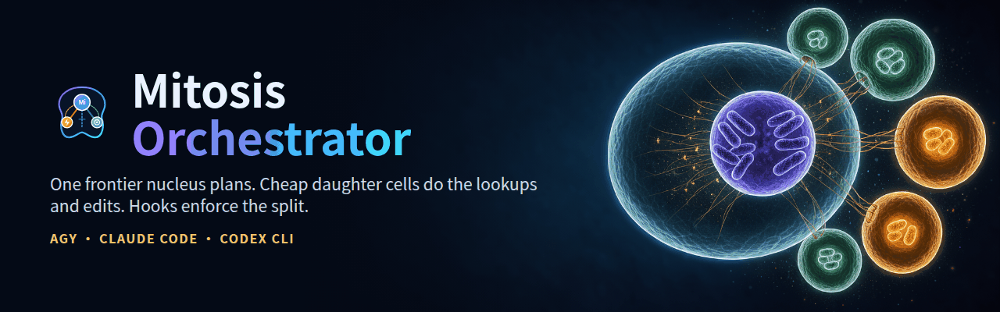
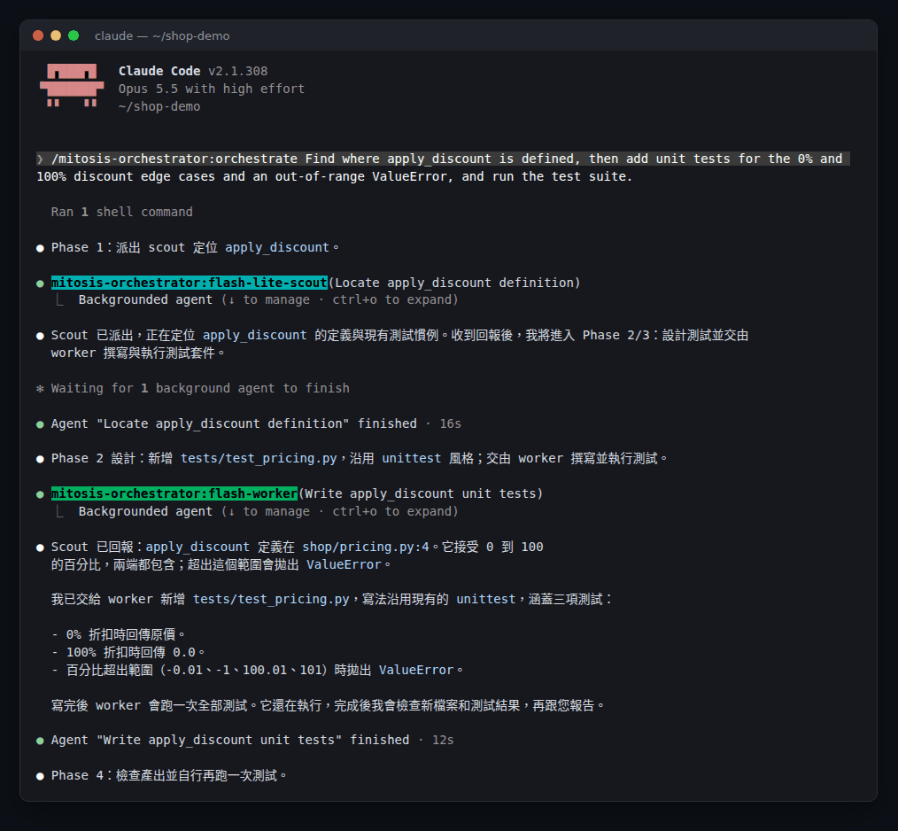
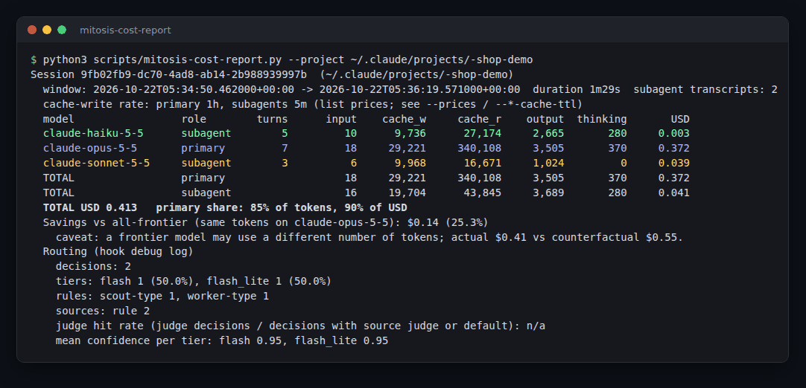
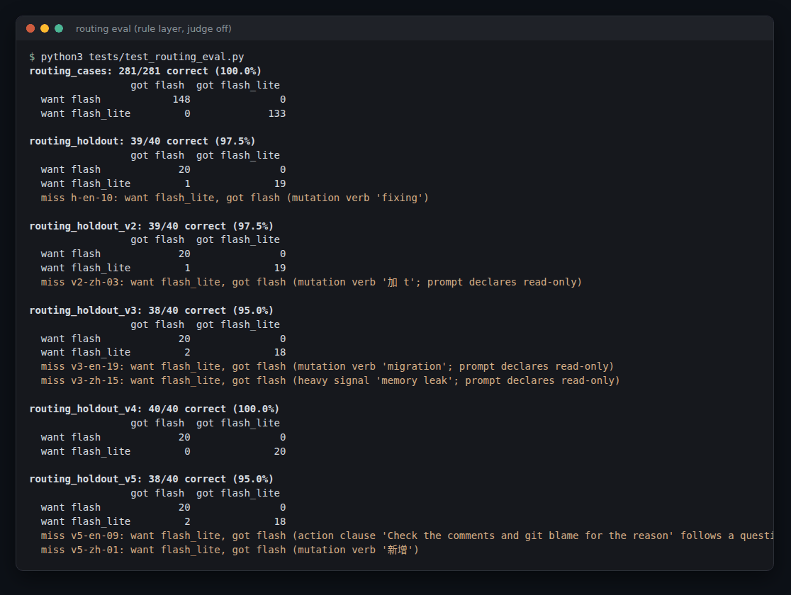

# Mitosis Orchestrator (`mitosis-orchestrator`)

[](https://github.com/ivanusto/mitosis-orchestrator/actions/workflows/ci.yml)

<p align="center">
  
</p>

<p align="center">
  <strong>跨模型有絲分裂編排外掛，支援三大 AI CLI 平台</strong><br/>
  <em>Google Antigravity (<code>agy</code>) · Anthropic Claude Code · OpenAI Codex CLI</em><br/>
  <a href="./README.md">English Documentation (README.md)</a> · <a href="./CHANGELOG.md">版本紀錄 (Changelog)</a> · <a href="./SECURITY.md">安全性 (Security)</a> · <a href="./CONTRIBUTING.md">貢獻指南 (Contributing)</a> · <a href="./rules/AGENTS.md">編排規則 (Rules)</a>
</p>

---

## 專案簡介：為什麼命名為 Mitosis（有絲分裂）？

靈感源自生物學的**細胞有絲分裂（Mitosis）**。**Mitosis Orchestrator** 將您選用的**尖端推理模型（Frontier Model）**定位為系統的**主核架構師（Master Nucleus）**。主核不再把昂貴的 Token 與上下文視窗消耗在單檔搜尋、原始 Log 翻找或反覆的「修改後再跑測試」迴圈，而是將複雜的工程任務有紀律地「分裂」並平行委派給兩類專職子細胞（Subagents）：

- **主核架構師（Primary Frontier Orchestrator）**：專注於高階架構設計、API 介面契約、跨模組重構決策、資安與並行性把關，以及最終結果的統合驗證。
- **執行子代理（`flash-worker` · `worker`）**：負責跨檔案程式碼探索、呼叫圖（Call-Graph）追蹤、外部文件查證、撰寫與執行測試，以及在明確允許清單內的局部修改。
- **偵察子代理（`flash-lite-scout` · `explorer`）**：負責高併發、低延遲的唯讀單跳偵察：快速定位檔案與符號、執行 `grep`/`glob` 搜尋、切片檢視 `.log` 與 `transcript.jsonl`，以及單一檔案結構摘要。

## 實際畫面

在小型示範專案上以 Claude Code（主核 Opus 5.5）實際執行 `/orchestrate`。主核先派 `flash-lite-scout` 找出函式位置，再派 `flash-worker` 撰寫並執行測試，最後自己複查結果：

<p align="center"></p>

同一場工作階段的 `scripts/mitosis-cost-report.py` 報表：scout 跑在 haiku、worker 跑在 sonnet，費用大部分仍來自主核（見 [Claude Code 主核模型選擇](./docs/cost.zh-TW.md#claude-code-主核模型選擇fable-51-與-opus-55)）：

<p align="center"></p>

路由評測（`python3 tests/test_routing_eval.py`）：所有標註資料集都沒有把執行者的任務送給唯讀的偵察者（見[路由評測](#路由評測)）：

<p align="center"></p>

---


## 快速開始

選你使用的 CLI。每一段都有安裝指令，以及一行更新指令。

**Claude Code**

```bash
# 安裝
claude plugin marketplace add ivanusto/mitosis-orchestrator
claude plugin install mitosis-orchestrator@mitosis-orchestrator

# 更新（完成後開新 session）
claude plugin marketplace update mitosis-orchestrator && claude plugin update mitosis-orchestrator@mitosis-orchestrator
```

**OpenAI Codex CLI**

```bash
# 安裝
git clone https://github.com/ivanusto/mitosis-orchestrator.git ~/mitosis-orchestrator
python3 ~/mitosis-orchestrator/scripts/setup-codex.py
codex plugin marketplace add ~/mitosis-orchestrator
codex plugin add mitosis-orchestrator@mitosis-orchestrator
# 接著在 ~/.codex/config.toml 的 [features] 設 hooks = true，開啟 Codex 並在 /hooks 核准外掛 hook

# 更新（重新 add 會刷新外掛快照；Codex 若要求，請到 /hooks 重新核准）
git -C ~/mitosis-orchestrator pull && python3 ~/mitosis-orchestrator/scripts/setup-codex.py && codex plugin add mitosis-orchestrator@mitosis-orchestrator
```

**Google Antigravity（`agy`）**

```bash
# 安裝（agy 會自動載入外掛目錄下的每個子目錄）
git clone https://github.com/ivanusto/mitosis-orchestrator.git ~/.gemini/config/plugins/mitosis-orchestrator

# 更新
git -C ~/.gemini/config/plugins/mitosis-orchestrator pull
```

確認是否生效：開新 session 會出現 `[Mitosis Orchestrator Active] ...` 橫幅，指令清單裡有 `/orchestrate`。完整選項、需求與各安裝腳本會改動的內容，請見[安裝與設定方式](#安裝與設定方式)。

---

## 支援的主核尖端模型清單

Mitosis Orchestrator 在三大平台都支援尖端推理模型擔任主核，並透過邊界正規表示式攔截輕量模型擔任主代理：

| 模型廠商 | 支援作為主代理的尖端模型 (Primary Orchestrator) | 自動攔截的輕量級模型 (Small-Tier Filter) |
| :--- | :--- | :--- |
| **OpenAI** (Codex CLI / API) | **`gpt-6.1-sol`**、**`gpt-5.6-sol`**、`gpt-5.6-terra`、`gpt-6-astra`、`o1`、`o3`、`o4` | `gpt-5.6-luna`、`gpt-5.4-mini`、`o4-mini`、`o3-mini`、`gpt-4.1-mini` |
| **Anthropic** (Claude Code) | **`fable`**（Claude Fable 5.1）、**`opus`**（Claude Opus 5.5）、`sonnet`（Claude Sonnet 5.5） | `haiku`（Claude Haiku 5.5、`claude-haiku-*`） |
| **Google Gemini** (Antigravity `agy`) | `Gemini 4 Argon (High / Medium)`、`Gemini Pro`、`Gemini Ultra` | `gemini-3-flash`、`gemini-flash-lite`、`gemini-nano` |
| **xAI** | `Grok 3`、`Grok 4`、`grok-3`、`grok-4`、`grok-3-thinking` | `grok-3-mini`、`grok-3-mini-fast` |
| **DeepSeek** | `DeepSeek-R1`、`DeepSeek-V3`、`deepseek-reasoner`、`deepseek-chat` | `deepseek-lite` |
| **Alibaba Qwen** | `Qwen Max`、`Qwen Plus`、`Qwen 2.5 / 3`、`QwQ`（`qwq-32b`） | `qwen-lite`、`qwen-vl-lite` |

> [!NOTE]
> 內建邊界過濾器（`(?<![a-z0-9])(flash|lite|mini|nano|haiku|luna|spark)(?![a-z0-9])`）排除 `mini`、`flash`、`lite`、`haiku`、`nano`、`luna`、`spark` 輕量模型，同時確保 `gemini` 不會誤判。

---

## Claude Code 主核模型選擇：Fable 5.1 與 Opus 5.5

- 建議預設：`opus` 搭配 `medium` effort；scout（`haiku`）與 worker（`sonnet`）由 hook 釘定。
- 數小時自主長跑、需求模糊、牽涉隱含不變量的跨模組重構與深度審查，改用 `fable`。
- 實測 session 中主核占總費用 70% 到 85%，因此主核模型與 effort 是最大的成本控制桿。
- 價格、示例試算、成本報表與子細胞調整，見 [docs/cost.zh-TW.md](./docs/cost.zh-TW.md)。

---

## 安裝與設定方式

需求：Python 3.11 以上（只用標準函式庫；Codex 安裝腳本用到 `tomllib`）、`git`。

### 平台一：Google Antigravity (`agy` 1.4 以上)

```bash
git clone https://github.com/ivanusto/mitosis-orchestrator.git ~/mitosis-orchestrator
agy plugin install ~/mitosis-orchestrator
agy plugin list            # mitosis-orchestrator (enabled, 2.3.0)
```

也可以直接 clone 到全域外掛目錄，`agy` 會自動載入該目錄下的每個外掛：

```bash
git clone https://github.com/ivanusto/mitosis-orchestrator.git ~/.gemini/config/plugins/mitosis-orchestrator
agy plugin validate ~/.gemini/config/plugins/mitosis-orchestrator --strict
```

> [!WARNING]
> 若仍裝著前身 `argon-orchestrator`，請先移除（`agy plugin uninstall argon-orchestrator`）。兩者的 skill 都叫 `orchestrate`、agent 都叫 `flash-worker` / `flash-lite-scout`，同時啟用會互相衝突並跑兩套 hook。

### 平台二：Anthropic Claude Code (2.1.292 以上)

本 repo 本身就是單一外掛的 marketplace（`.claude-plugin/marketplace.json`），可直接從 GitHub 安裝：

```bash
claude plugin marketplace add ivanusto/mitosis-orchestrator
claude plugin install mitosis-orchestrator@mitosis-orchestrator
claude plugin list         # mitosis-orchestrator@mitosis-orchestrator  ✔ enabled
```

之後更新：`claude plugin marketplace update mitosis-orchestrator && claude plugin update mitosis-orchestrator@mitosis-orchestrator`。

本機開發時改用本機路徑當 marketplace（`claude plugin marketplace add /path/to/mitosis-orchestrator`），或只在單次 session 載入：

```bash
claude --plugin-dir /path/to/mitosis-orchestrator
```

載入內容：`hooks/hooks.json`（SessionStart / UserPromptSubmit / PreToolUse / PostToolUse / SubagentStop / Stop）、`/orchestrate` skill，以及兩個可由 `Agent` 工具呼叫的子代理：`subagent_type: "mitosis-orchestrator:flash-lite-scout"`（haiku，effort `low`）與 `subagent_type: "mitosis-orchestrator:flash-worker"`（sonnet，effort `medium`）。驗證方式：開新 session 後應看到 `[Mitosis Orchestrator Active] Primary model is 'fable'.` 橫幅，且 `/orchestrate` 出現在指令清單。

### 平台三：OpenAI Codex CLI (0.134 以上；已於 0.154.0 與 0.163.0 驗證)

```bash
git clone https://github.com/ivanusto/mitosis-orchestrator.git ~/mitosis-orchestrator
python3 ~/mitosis-orchestrator/scripts/setup-codex.py
codex exec --profile mitosis-scout "Locate where parse_token is defined"
```

安裝腳本可重複執行，依序完成：

1. **自動備份**：將 `$CODEX_HOME/config.toml` 複製為 `config.toml.bak`（`$CODEX_HOME` 預設 `~/.codex`）。
2. **同步規則**：將 `rules/AGENTS.md` 複製至 `$CODEX_HOME/AGENTS.md`。
3. **安裝角色**：將角色檔安裝至 `$CODEX_HOME/agents/`：`explorer.toml` 與 `flash-lite-scout.toml`（`gpt-5.6-luna`、`low`）、`worker.toml` 與 `flash-worker.toml`（`gpt-5.6-terra`、`medium`）。主代理可透過 `spawn_agent(agent_type=...)` 選用；`flash-*` 角色檔只有執行過這個安裝腳本後才存在。
4. **安裝 profile**：將 `mitosis-scout.config.toml` 與 `mitosis-worker.config.toml` 複製至 `$CODEX_HOME/`（Codex 0.134 起 `--profile <name>` 讀取 `$CODEX_HOME/<name>.config.toml`，舊的 `[profiles.*]` 區段已不再生效）。
5. **注入 MCP**：在 `config.toml` 寫入 `[mcp_servers.mitosis]`，使用執行安裝腳本的 Python 直譯器與 `scripts/mitosis-mcp-server.py` 的絕對路徑。
6. **完整性驗證**：校驗所有 TOML 並確認檔案存在。

MCP server 執行偵察子代理時使用 `--sandbox read-only`，執行子代理使用 `--sandbox workspace-write`；只有設定 `MITOSIS_CODEX_YOLO=1` 才會改用 `--dangerously-bypass-approvals-and-sandbox`。

1.7.0 起，外掛 hook 會把 `spawn_agent` 呼叫改寫為 Codex 內建的 `explorer`（偵察者）與 `worker` 角色，因為 Codex 0.163 會拒絕未知的 `agent_type`（`unknown agent_type '...'`），而 `flash-*` 角色在只安裝外掛時並不存在。模型與 effort 預設為 `gpt-5.6-luna` / `gpt-5.6-terra` 與 `low` / `medium`，可用 `CODEX_MITOSIS_SCOUT_MODEL`、`CODEX_MITOSIS_WORKER_MODEL`、`CODEX_MITOSIS_SCOUT_EFFORT`、`CODEX_MITOSIS_WORKER_EFFORT` 覆寫。這些值會經過驗證（模型會被嵌入 `codex exec -m` 指令），且沒有 `AGY_` 形式。`setup-codex.py` 會用生效後的值產生角色與 profile TOML，並透過 MCP 的 `env` 表傳給 MCP server。

### 外掛 hook（Codex 0.128 以上）

Codex 也可以把 hook 當成外掛載入：

```bash
codex plugin marketplace add <path-to-repo>
codex plugin add mitosis-orchestrator@mitosis-orchestrator
```

請在 `config.toml` 啟用 hooks 功能，接著開啟 Codex，在 `/hooks` 核准外掛 hook；未受信任的 hook 會被靜默略過（新版改了 matcher 時要重新核准）。MCP server、agent 角色與 profile 仍需執行 `setup-codex.py`。

Codex 0.163（multi-agent v2）在 hook payload 裡把代理工具命名為 `collaboration<工具名>`（`collaborationspawn_agent`、`collaborationfollowup_task`、`collaborationsend_message`），而且 `message` 是加密字串。1.8.0 起 hook 會去掉 namespace 前綴，用 `task_name` 登記每個子代理（也就是 `followup_task` / `send_message` 的 `target`）；因為讀不到內容，送給偵察子代理的追加指令改為直接拒絕，不再逐字檢查。2.0 起，子代理自己的 hook（帶的是 `agent_id`，不是 `task_name`）會透過子代理 rollout 的第一行（`session_meta.agent_path`）綁定到對應紀錄，否則綁定到同角色中唯一尚未綁定的紀錄；`SubagentStop` 會更新該筆紀錄（stops、`last_turn_id`、`report_ok`）。2.1 起，若已綁定的偵察或執行子代理最後訊息不是四標頭回報（常見原因是尖端模型在讀不到的 `spawn_agent` 訊息裡自訂了標頭），會退回一次（`{"decision":"block"}`，Codex 讓子代理重答，第二次 `SubagentStop` 帶 `stop_hook_active: true`）。已於 Codex 0.163 驗證：`SubagentStop` 退回後，子代理會重新回答，主代理收到的是修正後的回報。代理定義檔註明四標頭優先於任務訊息，SessionStart 提示也會告訴主代理不要自訂回報標頭。在 Codex 執行環境設定 `CODEX_MITOSIS_DEBUG=1`，每次 hook 呼叫（原始工具名、輸入鍵、state）都會記到 `$TMPDIR/mitosis-orchestrator/<session>/mitosis_orchestrator_debug.log`。

---

## 核心組件與安全防護機制

### 1. 生命週期強制守衛 ([`hooks.json`](./hooks.json) · [`hooks/hooks.json`](./hooks/hooks.json) · [`scripts/enforce-orchestrator.py`](./scripts/enforce-orchestrator.py))
零外部依賴（僅 Python 3.8+ 標準函式庫；入口腳本加上 [`scripts/mitosis_hook/`](./scripts/mitosis_hook) 套件），每次呼叫約 30 毫秒，於每個代理生命週期自動把關。Claude Code 端的 `PreToolUse` matcher 只涵蓋引擎真正檢查的工具（`Agent`、`Task`、`Bash`、`Read`、`NotebookRead`、`Write`、`Edit`、`NotebookEdit`、`SendMessage`），`Grep` / `Glob` / `WebFetch` / MCP 呼叫不再付 hook 啟動成本：

| Hook 事件 | 防護機制與行為說明 |
| :--- | :--- |
| `SessionStart` | 讀取設定檔，若主模型不是支援的尖端模型則發出**警告**並注入 Mitosis 編排政策；僅在啟用 `*_MITOSIS_PIN_SETTINGS=1` 時改寫設定檔。 |
| `PreInvocation`（agy）· `UserPromptSubmit`（Claude Code / Codex） | 每回合檢查即時模型；若切換到非尖端模型，每回合提醒一次。同時重設單回合編輯計數（`turn_edited_files`）與連續失敗計數（`consecutive_failures`）。 |
| `PreToolUse` · `invoke_subagent`（agy） | 自動判定子代理應綁定執行或偵察層級。強訊號（測試、除錯、修改動詞）一律優先於查找關鍵字；偵察子代理被指派修改任務時自動升級為執行子代理；提示詞缺少 `REPORT FORMAT` 區塊時自動補上。 |
| `PreToolUse` · `Agent`（Claude Code） | **只**改寫本外掛自己的型別（`flash-worker`、`flash-lite-scout`，有無 `mitosis-orchestrator:` 前綴皆可）與未指定型別且 `model: inherit` 的 `Agent` 呼叫。其他外掛的 agent、內建型別（`Explore`、`Plan`、`general-purpose` 等）與明確指定模型的呼叫一律原樣放行。同時釘定 `effort`（scout `low`、worker `medium`；呼叫端自帶的合法值優先；`CLAUDE_MITOSIS_PIN_EFFORT=0` 關閉），並為缺少 `REPORT FORMAT` 區塊的提示詞自動補上（`CLAUDE_MITOSIS_APPEND_REPORT_FORMAT=0` 關閉）。`CLAUDE_MITOSIS_PIN_SUBAGENTS=0` 可整個關閉。 |
| `PreToolUse` · `spawn_agent` / `codex exec`（Codex） | 依提示詞分類，將子代理綁定到 `gpt-5.6-luna`（偵察）或 `gpt-5.6-terra`（執行）。Codex 不讓 hook 讀訊息時（0.163 傳的是加密字串），改依呼叫指定的 `agent_type` 決定，訊息原樣保留；沒指定角色的呼叫一律綁到 `worker`。 |
| `PreToolUse` · `send_message`（agy / Codex）· `SendMessage`（Claude Code）· `followup_task`（Codex） | 攔截對偵察子代理發送程式碼修改或超過 3 個編號步驟的追加指令；Codex 的 `followup_task` 另外比照新任務分類。Claude Code 端的收件者以 `PostToolUse` / `SubagentStop` 配對到的 agent id 辨識，Codex 端以 `spawn_agent` 時登記的 `task_name` 辨識。hook 讀不到內容的 Codex 追加指令，送給偵察子代理一律拒絕，請改開新的 explorer 或交給 worker。 |
| `PreToolUse` · 偵察子代理自己的工具（Claude Code / Codex） | `flash-lite-scout` 與 Codex `explorer` 不論提示詞怎麼寫，都不能用 `Write` / `Edit` / `apply_patch`，shell 只能跑白名單內的唯讀指令。 |
| `PreToolUse` · `run_workflow` | 攔截工作流腳本中未明確指定子代理模型層級的呼叫。 |
| `PreToolUse` · `define_subagent` | 強制 `enable_subagent_tools=false`，防止子代理無限巢狀衍生。 |
| `PreToolUse` · **情境整潔守衛 (Context Hygiene)** | 攔截主代理直接讀取 `.log` 或 `transcript.jsonl` 原始大檔，改由偵察子代理切片摘要。 |
| `PreToolUse` · **快捷修改預算 (Fast-Path Budget)** | 限制主代理單回合直接修改工作區檔案上限 `3` 個（`*_MITOSIS_MAX_DIRECT_EDITS` 可調），並禁止主代理在同回合直接修改檔案後執行測試框架。 |
| `PreToolUse` · **兩次失敗熔斷器 (Circuit Breaker)** | 指令或子代理呼叫連續失敗達 `2` 次即熔斷，阻止無效重試並要求回報阻礙原因。 |
| `PreToolUse` · **工作區範圍守衛 (Workspace Guard)** | 選用（`*_MITOSIS_AUTO_ALLOW=1`）：工作區內的檔案讀寫與安全命令自動放行；跨出工作區、提權或危險指令轉為詢問（`ask`；Codex 沒有 `ask`，改為 `deny`）。未啟用時不表態：Claude Code 端回傳 `{}`，沿用使用者原本的權限規則與提示（1.5.0 以前回傳 `allow`，會略過權限提示）。 |
| `PostToolUse` | 配對新建子代理中繼資料，並更新連續失敗計數。 |
| `SubagentStop` / `Stop` | 回合閒置且仍有存活的分支工作樹時，提醒主代理先合併或捨棄變更並清理。Claude Code 與 Codex（僅限已綁定的子代理，Codex 以 `CODEX_MITOSIS_ENFORCE_REPORT=0` 關閉）的 `SubagentStop` 另會檢查 `flash-lite-scout` / `flash-worker` 是否以四標頭回報結尾，不符時每個子代理退回一次要求重寫（`CLAUDE_MITOSIS_ENFORCE_REPORT=0` 關閉）。 |

#### 失敗升級（2.3）

- **觸發條件。** mitosis 偵察者回報 `STATUS: FAILED` 或 `BLOCKED`。Claude Code 在 `SubagentStop`（背景 `Agent` 呼叫只會在此時交付回報）或同步的 `PostToolUse` 結果偵測；Codex 在已綁定 explorer 的 `SubagentStop` 偵測；agy 不涵蓋。
- **效果。** 下一次路由到偵察者的派發改由執行者處理（規則 `escalation`），只升級一次，限 3 次派發或 30 分鐘內。已升級的派發不會再次升級。未指定類型的呼叫不會被加上 `subagent_type`，只會被指定模型。
- **選用。** `*_MITOSIS_ESCALATE_PRIMARY=1`（僅 Claude Code）會讓失敗的執行者之後的下一次派發改用主核模型。`*_MITOSIS_ESCALATE=0` 關閉升級。
- **無頭驗證。** 被要求讀取不存在檔案的偵察者回報 `BLOCKED`，同一個標為偵察者的重新派發改以 sonnet 的 `mitosis-orchestrator:flash-worker` 執行（該工作階段花費 0.25 美元）。
- 2.3 起背景 `Agent` 啟動（`{"isAsync": true, "agentId": ...}`）也會被登記，因此 `SendMessage` 的偵察者防護看得到它們。

### 2. 有界四標頭子代理回報合約 (Bounded 4-Header Report Contract)
所有偵察與執行子代理都採用極簡四標頭格式回報（總長 ≤ 1,600 字元、`NOTES:` 下最多 10 行清單，狀態為 `BLOCKED` 或 `FAILED` 時必須附 `file://.../*.log` 日誌連結）：

<!-- BEGIN GENERATED: report-format -->
```markdown
STATUS: COMPLETED | BLOCKED | FAILED
FILES_CHANGED: <以逗號分隔的檔案路徑或 NONE>
VERIFICATION: <一句話說明執行的驗證命令與結果>
NOTES: <一句話說明發現，或最多 10 行 `- ` 清單；若 BLOCKED/FAILED 須含 file:// log URI>
```
<!-- END GENERATED: report-format -->

### 3. `/orchestrate` 四階段編排技能 ([`skills/orchestrate/SKILL.md`](./skills/orchestrate/SKILL.md))
1. **階段一：平行偵察 (Scout / Explorer Fan-Out)**：派發唯讀偵察子代理進行高速檔案與符號探索。
2. **階段二：架構設計與拆解 (Primary Master Nucleus)**：由主核彙整偵察結果、制定架構介面並切分獨立工作單元。
3. **階段三：範圍執行與測試 (Workers)**：派發執行子代理於指定檔案清單內完成實作與測試驗證。
4. **階段四：統合驗證與分支清理 (Primary Master Nucleus)**：檢視差異、完成最終驗證並清理工作樹。

---

## 三平台情境路由矩陣 (v1.5.0)

| 層級 | Google Antigravity (`agy`) | Anthropic Claude Code | OpenAI Codex CLI | 角色定位與職責範圍 |
| :--- | :--- | :--- | :--- | :--- |
| **主核架構師 (Master Nucleus)** | `Gemini 4 Argon (High/Medium)` / 尖端模型 | `fable` / `opus` / `sonnet` | **`gpt-6.1-sol`** / `gpt-5.6-sol` / `gpt-6-astra` / `o3` | 系統架構設計、多步驟任務拆解、跨模組重構、複雜邏輯與資安把關、向使用者釐清需求與最終彙整。 |
| **執行子代理 (Worker)** | `flash` via [`flash-worker`](./agents/flash-worker/agent.md) | `sonnet` via [`mitosis-orchestrator:flash-worker`](./claude-agents/flash-worker.md) | **`gpt-5.6-terra`** via [`worker`](./codex-agents/worker.toml) / [`flash-worker`](./codex-agents/flash-worker.toml) 或 `--profile mitosis-worker` | 跨檔案探索、呼叫圖追蹤、撰寫與執行單元/整合測試、允許清單內的局部修改（`workspace-write`）。 |
| **偵察子代理 (Scout)** | `flash_lite` via [`flash-lite-scout`](./agents/flash-lite-scout/agent.md) | `haiku` via [`mitosis-orchestrator:flash-lite-scout`](./claude-agents/flash-lite-scout.md) | **`gpt-5.6-luna`** via [`explorer`](./codex-agents/explorer.toml) / [`flash-lite-scout`](./codex-agents/flash-lite-scout.toml) 或 `--profile mitosis-scout` | 快速檔案與符號查找、`grep`/`glob` 搜尋、`git status`/`git log` 檢查、Log 切片檢視與輕量摘要（`read-only`）。 |


### 信心分級分流與選用判斷器（v1.5.0）

每次分流都會產生一個 `Decision`，欄位包括 `tier`、`effort`、`confidence`、`source`（`rule`、`judge` 或 `default`）、`rule` 與 `reason`。開啟 `*_MITOSIS_DEBUG=1` 後，每筆決策會以 `decisions` 欄位寫進除錯日誌，從中可以看出是哪條規則觸發、信心多高。

```
關鍵字規則 ──► 信心 ≥ 0.9 ────────────────────────────────► 採用規則
      │
      └─ 信心 < 0.9 且設了 MITOSIS_JUDGE_URL ──► 判斷器 ──► 有把握 ──► 採用判斷器
                                                  └──► 不確定或錯誤 ──► flash（不會讓任務失敗）
```

- **規則信心值。**
  - 0.95：明確型別、工作區模式、明確指定模型（這三類永遠不送判斷器），以及修改動詞
  - 0.9：重型訊號
  - 0.85：輕型訊號
  - 0.5：提示詞長度後備
- **唯讀宣告。** 提示詞若宣告唯讀（`read-only`、`do not modify anything`、`唯讀`），修改動詞與重型訊號的信心會降到 0.6。這類提示詞裡的那些字通常只是題目，例如「審查這些修正」「規劃遷移」。
- **否定規則放寬。** `Do NOT git fetch/pull or modify`、`never delete or rename` 現在都算禁止句；`don't X and fix Y` 仍視為要求修改。
- **判斷器預設關閉。**
  - 設定 `MITOSIS_JUDGE_URL` 就會啟用。請求採 Jev 的 `choice` 格式，所以 TypeSafe Jev、自架的 Jev 相容閘道與 Ollaya 可以互換。
  - 判斷器可以否決 scout 因修改動詞而升級，但不會推翻明確型別、工作區模式或明確指定的模型。
  - 沒有設定 URL 時，除了否定規則放寬之外，分流結果與 v1.4.1 相同。
- **隱私。** 送給判斷器的是提示詞前 2000 字元，並先遮蔽金鑰、電子郵件、IP 位址與家目錄路徑（見 [`scripts/mitosis_judge.py`](./scripts/mitosis_judge.py)）。如果提示詞不能離開本機，請改用本機閘道。
- **實際作用範圍。** Claude Code 的主核幾乎都會指定型別，所以判斷器主要處理未指定型別的呼叫與 Codex 的 `spawn_agent`。在 66 筆真實工作階段樣本中，帶型別的呼叫一次都沒有送到判斷器。

### 路由評測

只看規則層，判斷器關閉。儲存格格式為正確數/40、成本誤差、危險（「危險」指把應由執行者處理的任務送給唯讀的偵察者）。

| 資料集 | 角色 | v1.8.1 | v2.0.0 | v2.1.0 | v2.2.0 | v2.3.0 |
| :--- | :--- | :--- | :--- | :--- | :--- | :--- |
| routing_cases（183 -> 281 -> 361 -> 562） | 訓練 | 183/183，0 危險 | 281/281，0 危險 | 361/361，0 危險 | 562/562，0 危險 |
| 2.1 手寫反例（80，已併入 routing_cases） | 於 2.1.0 訓練 | | 44/80，15，21 | 80/80，0，0 | 80/80，0，0 | 80/80，0，0 |
| 2.2 手寫案例與審查探測（201，已併入 routing_cases） | 於 2.2.0 訓練 | | | 130/201，27，44 | 201/201，0，0 | 201/201，0，0 |
| 2.3 手寫案例與審查探測（293，已併入 routing_cases） | 於 2.3.0 訓練 | | | | 205/293，21，67 | 293/293，0，0 |
| holdout v1（40） | 已調校 | 39/40，1，0 | 39/40，1，0 | 39/40，1，0 | 39/40，1，0 | 39/40，1，0 |
| holdout v2（40） | 已調校 | 39/40，1，0 | 39/40，1，0 | 39/40，1，0 | 40/40，0，0 | 40/40，0，0 |
| holdout v3（40） | 已調校 | 36/40，4，0 | 38/40，2，0 | 38/40，2，0 | 38/40，2，0 | 38/40，2，0 |
| holdout v4（40） | 於 2.0.0 調校 | 33/40，7，0 | 40/40，0，0 | 40/40，0，0 | 40/40，0，0 | 40/40，0，0 |
| holdout v5（40） | 封存盲測，只評分一次；於 2.0.0 調校 | 29/40，10，1 | 首次 37/40，2，1；最終 38/40，2，0 | 39/40，1，0 | 39/40，1，0 | 39/40，1，0 |
| holdout v6（40） | 封存盲測，每版只評分一次；用來挑出 2.2 的缺口 | | 29/40，8，3 | 32/40，8，0 | 35/40，5，0 | 35/40，5，0 |
| holdout v7（40） | 封存盲測，每版只評分一次；兩筆誤判於事後修正 | | | 31/40，7，2 | 首次 34/40，4，2；最終 36/40，4，0 | 36/40，4，0 |
| holdout v8（40） | 封存盲測，每版只評分一次；一筆誤判於事後修正 | | | | 35/40，4，1 | 首次 35/40，4，1；最終 37/40，3，0 |

v5 在不接觸腳本與先前資料集的情況下撰寫，以 sha256（`160c44e16043fdfee4534dd5af8f4466a85ad2ce9f9ee10e4d2e74cac9cf42ad`）封存，並只對 2.0 候選規則評分一次。唯一的危險誤判（`v5-en-19`，帶動名詞的禮貌請求）在 1.8.1 同樣誤判；之後的 `polite-request` 規則只依新案例撰寫，因此 v5 已不再是盲測，下一輪調校必須先準備 v6。2.0.0 也修掉 1.8.1 既有的三類危險誤判（問句後接命令、管線中的 shell 變更、帶動名詞的禮貌請求），這些規則不交給判斷器裁決。已知限制：規則層仍以字面比對為主，尚無 embedding 階段。

v6（sha256 `69d3cec3e684453d510898557d13d7eb0abaad61aa09599c60bb688ef331daf9`）由子代理盲寫，於 commit 1c5d524 封存，並於 2026-10-22 以獨立程序各評分一次：2.0.0 為 29/40，8 筆成本誤差，3 筆危險；2.1.0 為 32/40，8 筆成本誤差，0 筆危險。其中 4 筆成本誤差是標為 `flash-worker` 的查詢，這類呼叫一律交給執行者。封存後未再依 v6 調校。

v7（sha256 `8b6bf9167d44663ce7745ec5f79102cbdb00e4e3ed7e3afb2a6d438d2743273c`）由子代理盲寫，於 commit 7dffeb0 封存，並於 2026-10-22 以獨立程序各評分一次：2.1.0 為 31/40，7 筆成本誤差，2 筆危險；2.2 候選版（c648116）為 34/40，4 筆成本誤差，2 筆危險。兩筆危險誤判（標為偵察者、卻以行動開頭或執行寫入指令的提示詞）隨後依新的手寫案例以通用規則修正（416f754）：36/40，4 筆成本誤差，0 筆危險。因此 v7 已不再是盲測。其餘成本誤差包括一筆標為 `flash-worker` 的查詢（維持交給執行者），以及一筆提到 fix/pytest 的唯讀問題。

v8（sha256 `f9824228436592160454357236a858da84cc9a4289879d159695ce5786470d51`）由子代理盲寫，於 commit 27914e3 封存，並於 2026-10-22 以獨立程序各評分一次：2.2.0 為 35/40，4 筆成本誤差，1 筆危險；2.3 候選版（e237483）為 35/40，4 筆成本誤差，1 筆危險，且是同樣五筆誤判。那筆危險誤判（標為偵察者、比較第三方框架現行文件，因此需要網路）隨後依新的手寫案例以通用規則修正（d0b2624）：37/40，3 筆成本誤差，0 筆危險。因此 v8 已不再是盲測。2.3 的規則工作並未提升盲測分數：兩個版本錯的是同樣五個提示詞。2.3 的進步來自 175 筆私下審查探測（分七批；在 293 筆新案例上，2.2.0 為 205/293，其中 67 筆危險），每一批都揭露了在「類型優先」預設下的新動作句型，所以 2.3 將標為偵察者之呼叫的預設反轉。v8 其餘的成本誤差是兩筆標為 `flash-worker` 的查詢（維持交給執行者）與一筆簡體中文問句。

**2.1 路由新增項目。**
- 只是詢問「哪個指令會執行某事」的執行用語視為主題；若仍殘留「並執行它」之類的要求，仍會升級。
- 標為 `flash-lite-scout` 的呼叫，若需要網路存取（`scout-web`，0.9）、在問句之後以行動結尾（`trailing-imperative`），或仍要求執行（`run-directive`，0.9），會升級給執行者。
- 標為偵察者的呼叫若在最後一句聲明唯讀，則維持由偵察者處理（`scout-read-only`，0.7，可交由判斷器裁決）。
- 新增委婉請求句型："would it be possible to"、"appreciate it if you" 加過去式、"it would be great if you" 加動詞。
- 沒有問號的問句（助動詞倒裝、"I wonder"、"not sure"、"curious"、不確定／不知道／想知道／好奇）也會啟動 trailing-imperative 檢查。
- 新增中文動詞（弄成、弄好、搞定、拉到、換掉、改掉、調成、調大、調小）與查詢用語（弄清楚、搞清楚、釐清）。
- 已知缺口（2.2 已補上）：標為 `flash-worker` 的查詢、超過 600 字元的偵察者提示詞略過 trailing-imperative 檢查、清單以外的中文動詞。

**2.2 路由新增項目。**
- `worker-lookup`：標為 `flash-worker`、簡短且單純唯讀的查詢，改以偵察者類型交給偵察者（0.7，可交由判斷器裁決）。設定 `*_MITOSIS_WORKER_DOWNGRADE=0` 可關閉。任何修改、執行、非唯讀指令、需要網路、大範圍研究或含非讀取子句的呼叫，仍留在執行者。
- 過長（超過 600 字元）的偵察者簡報會檢查最後一段是否含行動子句。
- `scout-imperative`（0.85）：標為偵察者、第一個子句以非讀取動詞開頭的提示詞會升級，中英文皆適用。
- `run-directive` 也涵蓋 run／跑／執行 加上偵察者無法執行的指令；"you may run"、"feel free to run"、可以執行 屬於許可，不算要求。
- 中文的把／將處置式、及物的 X掉 與結果補語視為修改；被字句、要不要／是否句型與為什麼／在哪裡的問句視為主題。
- 禮貌句型（請／幫我）可接任何非讀取動詞。
- 唯讀的後續要求：只要讀、只需確認、不必重現、"paste the output"。
- "from the web process" 與讀取本機 CHANGELOG 不再被視為需要網路。
- 已知缺口（2.3 已補上）：未列入清單的英文動詞搭配一般小寫受詞；子句未使用把／將或結果補語時，清單以外的中文動作動詞。

**2.3 路由新增項目。**
- `scout-unproven`（0.6，可交由判斷器裁決）：標為偵察者的呼叫必須有正面的唯讀證據才會留在偵察者，否則交給執行者。證據包括：問句、讀取動詞（含 compare、review、summarize）、查詢訊號或唯讀指令、唯讀聲明、無動詞的名詞片語查詢，或簡短的「<識別字> in <檔案>」。情態與願望句、省略式的指派不算證據。
- 任何一句中的行動，以及主題分隔符之後的行動（"For api/routes.py: alphabetize ..."）都會被偵測。
- 未列入清單、搭配一般受詞的英文動詞，以及 "<動詞> out" 片語動詞視為行動。
- 中文的程式碼修改動詞、替／給／幫 加動詞，以及動詞 加結果補語 加程式碼詞彙，視為行動。
- 執行器狀態問句（"Does mypy pass on main?"、目前有沒有過）需要實際執行；提到 pytest 或 fix 的設定、標記、fixture 與歷史問題仍屬查詢。
- 不用／別 加讀取或執行動詞屬於限制，不是要求。
- 分裂句與 whether 句型已涵蓋，簡體中文亦同。
- 第三方文件、發行說明與參考資料需要網路。
- 全大寫識別字與檔名一律不當動詞。
- 已知缺口：規則層仍以字面比對為主，尚無 embedding 階段；v8 撰寫者的誤判落在 2.3 探測都沒涵蓋的類別，預期還會出現新句型；標為 `flash-worker` 的查詢除非簡短單純，否則仍留在執行者；上方的失敗升級是安全網。

先前輪次（1.6.0 到 1.7.0），儲存格格式為正確數/40、危險：

| 資料集 | 1.7.0 中的角色 | v1.6.0 | v1.7.0 |
| :--- | :--- | :--- | :--- |
| routing_cases（120 -> 183） | 訓練 | 119/120，0 危險 | 183/183，0 危險 |
| holdout v1（40） | 於 1.5.1 與 1.7.0 調校 | 32/40，0 | 39/40，0 |
| holdout v2（40） | 盲測基準，之後轉為訓練 | 25/40，4 | 39/40，0 |
| holdout v3（40） | 第一輪調校後的首次盲測，之後轉為訓練 | 25/40，9 | 首次 29/40，6；調校後 36/40，0 |
| holdout v4（40） | 盲測，只評分一次，未調校 | 25/40，8 | 33/40，0 |

1.5.1 的「零危險」結果沒有推廣到新資料：三組全新的盲測集在 v1.6.0 上各有 4 到 9 筆危險誤判。1.7.0 第一輪調校擬合了訓練集，但盲測分數幾乎沒有變動。v3 剩下的六筆危險誤判全部來自短提示詞的退路規則，因此 1.7.0 改為把沒有查詢訊號的提示詞送給執行者（代價是成本誤差，而不是偵察者執行失敗），並新增執行、CLI 與文件查詢的訊號。v4 當時剩下的 7 筆錯誤都是把查詢送給執行者（只多花成本，不會失敗），也就是提到 debug、migration 或 build 等字眼的唯讀問題；2.0.0 已在規則層修正這一類（見上表）。

---

## 環境變數設定

所有變數都接受 `AGY_MITOSIS_*`、`CLAUDE_MITOSIS_*`、`CODEX_MITOSIS_*` 三種前綴（舊版 `AGY_ARGON_*` 仍相容）：

| 環境變數 | 預設值 | 功能說明 |
| :--- | :--- | :--- |
| `*_MITOSIS_PIN_SETTINGS` | `0` | 設為 `1` 時，Session 啟動時自動把設定檔改寫為指定的主核尖端模型。 |
| `*_MITOSIS_PRIMARY_MODEL` | `Gemini 4 Argon (High)` · `opus` · `gpt-6.1-sol` | 啟用自動綁定時的目標模型（依平台預設）。 |
| `AGY_ALLOW_NON_MITOSIS_PRIMARY` / `*_MITOSIS_ALLOW_NON_PRIMARY` | `0` | 設為 `1` 可關閉所有非尖端主模型的警告。 |
| `CLAUDE_MITOSIS_PIN_SUBAGENTS` | `1` | 設為 `0` 時 Claude Code 端完全不改寫 `Agent` 呼叫。 |
| `CLAUDE_MITOSIS_SCOUT_MODEL` · `CLAUDE_MITOSIS_WORKER_MODEL` | `haiku` · `sonnet` | Claude Code 各階層釘定的模型（`haiku`、`sonnet`、`opus`、`fable`）；不合法的值會退回預設。 |
| `CLAUDE_MITOSIS_PIN_EFFORT` | `1` | 設為 `0` 時 Claude Code 端不再為釘定的 `Agent` 呼叫加上 `effort`（模型仍會釘定）。 |
| `CLAUDE_MITOSIS_SCOUT_EFFORT` · `CLAUDE_MITOSIS_WORKER_EFFORT` | `low` · `medium` | Claude Code 各階層釘定的 effort（`low`、`medium`、`high`、`xhigh`、`max`）；呼叫端自帶的合法 `effort` 優先。 |
| `CLAUDE_MITOSIS_ENFORCE_REPORT` | `1` | 設為 `0` 時，`SubagentStop` 不再因最後訊息不是四標頭回報而退回外掛子代理。 |
| `CODEX_MITOSIS_ENFORCE_REPORT` | `1` | 設為 `0` 時，Codex 的 `SubagentStop` 不再因最後訊息不是四標頭回報而把外掛子代理退回一次。 |
| `*_MITOSIS_WORKER_DOWNGRADE` | `1` | 設為 `0` 時，所有標為 `flash-worker` 的呼叫一律留在執行者（預設會把簡短、單純唯讀的查詢改交給偵察者）。 |
| `*_MITOSIS_ESCALATE` | `1` | 設為 `0` 時關閉失敗升級（預設：偵察者回報 `STATUS: FAILED` 或 `BLOCKED` 後，下一次路由到偵察者的派發改由執行者處理，只升級一次，限 3 次派發或 30 分鐘內）。 |
| `*_MITOSIS_ESCALATE_PRIMARY` | `0` | 設為 `1` 時，失敗的執行者之後的下一次派發改用主核模型（僅 Claude Code）。 |
| `*_MITOSIS_APPEND_REPORT_FORMAT` | `1` | 設為 `0` 時，不再為缺少 `REPORT FORMAT` 區塊的子代理提示詞自動補上（agy `invoke_subagent`、Claude Code `Agent`）。 |
| `*_MITOSIS_AUTO_ALLOW` | `0` | 設為 `1` 時啟用互動模式下的工作區範圍自動放行守衛。 |
| `*_MITOSIS_MAX_DIRECT_EDITS` | `3` | 主代理單一回合可直接修改的不同工作區檔案數量上限。 |
| `*_MITOSIS_ALLOW_DIRECT_LOGS` | `0` | 設為 `1` 時允許主代理直接讀取 `.log` 與 `transcript.jsonl`。 |
| `*_MITOSIS_ALLOW_DIRECT_FASTPATH` | `0` | 設為 `1` 時允許主代理繞過單回合修改數量限制與「修改後跑測試」限制。 |
| `*_MITOSIS_CIRCUIT_BREAKER` | `1` | 設為 `0` 時停用連續 2 次失敗熔斷機制。 |
| `*_MITOSIS_DEBUG` | `0` | 設為 `1` 時在狀態檔旁的 `mitosis_orchestrator_debug.log` 記錄每次 Hook 呼叫的診斷 JSON。 |
| `MITOSIS_JUDGE_URL` | 未設定 | 低信心分流決策要送往的 Jev 相容端點；未設定即停用判斷器。 |
| `MITOSIS_JUDGE_KEY` · `MITOSIS_JUDGE_MODEL` | 未設定 · `jev-latest` | 送給判斷器的 Bearer 金鑰與模型名稱。金鑰只經 https，或送往本機與私有網段主機。 |
| `MITOSIS_JUDGE_ALLOW_HTTP_KEY` | `0` | 設為 `1` 時，金鑰也可經純 http 送往其他主機。 |
| `MITOSIS_JUDGE_THRESHOLD` · `MITOSIS_JUDGE_MIN_CONFIDENCE` | `0.9` · `0.7` | 規則信心低於前者才詢問判斷器；判斷器信心低於後者視為不確定，退回 `flash`。 |
| `MITOSIS_JUDGE_TIMEOUT` | `1.5` | 等待判斷器的秒數，逾時退回 `flash`。 |
| `CODEX_MITOSIS_SCOUT_MODEL` · `CODEX_MITOSIS_WORKER_MODEL` | `gpt-5.6-luna` · `gpt-5.6-terra` | Codex 各階層釘定的模型。只讀環境變數（沒有 `AGY_` 形式）；無效值退回預設。 |
| `CODEX_MITOSIS_SCOUT_EFFORT` · `CODEX_MITOSIS_WORKER_EFFORT` | `low` · `medium` | Codex 各階層釘定的推理 effort；無效值退回預設。 |
| `*_MITOSIS_LOCK_TIMEOUT` | `2` | 等待每個 session 狀態鎖的秒數，逾時即放行（前綴 `CLAUDE_`、`CODEX_` 或 `AGY_`）。 |
| `MITOSIS_OTEL` | `0` | 設為 `1` 時，每個路由決策送出一個 OpenTelemetry `invoke_agent` span（需搭配下列檔案或端點）。 |
| `MITOSIS_OTEL_FILE` | 未設定 | 每行附加一個 OTLP JSON 內容到此檔案。 |
| `OTEL_EXPORTER_OTLP_ENDPOINT` · `OTEL_EXPORTER_OTLP_TRACES_ENDPOINT` · `OTEL_EXPORTER_OTLP_HEADERS` | 未設定 | 標準 OTLP 設定。前者會附加 `/v1/traces`，第二個原樣使用，標頭格式為 `k=v,k2=v2`。 |
| `MITOSIS_OTEL_TIMEOUT` | `0.5` | 等待 OTLP 端點的秒數；所有遙測錯誤都會被吞掉。 |
| `MITOSIS_CODEX_YOLO` | `0` | 設為 `1` 時 Codex 子代理改用 `--dangerously-bypass-approvals-and-sandbox` 而非分級沙箱。 |

---

## 可觀測性

**OpenTelemetry（選用）。** 設定 `MITOSIS_OTEL=1`，並指定 `MITOSIS_OTEL_FILE` 或 OTLP 端點後，每個路由決策會產生一個符合 OpenTelemetry GenAI 慣例的 `invoke_agent {agent}` span。屬性有 `gen_ai.operation.name`、`gen_ai.provider.name`、`gen_ai.agent.name`、`gen_ai.request.model`、`gen_ai.conversation.id`，以及 `mitosis.tier`、`mitosis.rule`、`mitosis.confidence`、`mitosis.source`、`mitosis.platform`、`mitosis.effort`。span 標記的是路由決策的時間點（起訖相同），因為子代理稍後才在宿主 CLI 內執行。span 在 hook 回應送出後、狀態鎖釋放後才送出。

```bash
export MITOSIS_OTEL=1
export MITOSIS_OTEL_FILE=/tmp/mitosis-spans.jsonl                 # 與（或）：
export OTEL_EXPORTER_OTLP_ENDPOINT=http://localhost:4318
```

除錯日誌（`*_MITOSIS_DEBUG=1`）記錄相同的決策，現在也包含釘定的模型、effort 與平台。

**成本報表。** `scripts/mitosis-cost-report.py` 會列出相對於全尖端模型執行的節省金額，可輸出 `ccusage` 格式的 JSON，並從除錯日誌彙整路由統計（見[實際量測](./docs/cost.zh-TW.md#實際量測scriptsmitosis-cost-reportpy)）。

**狀態列（選用）。** 顯示每個 session 的偵察者與執行者數量，例如 `mitosis: scout 3 (1 live) | worker 2 | Opus | $1.23`。加入 `~/.claude/settings.json`：

```json
{"statusLine": {"type": "command", "command": "python3 <外掛路徑>/scripts/mitosis-statusline.py"}}
```

`MITOSIS_STATUSLINE_PREFIX` 可更改開頭標籤；發生任何問題時只會印出 `mitosis: idle`。

---

## 開發與測試

```bash
python3 -m unittest discover -s tests -v     # 471 個測試（hook、判斷器、成本報表、路由評測、打包檢查、Codex hook）
python3 tests/test_routing_eval.py          # 印出路由混淆矩陣
agy plugin validate . --strict
python3 scripts/smoke-claude.py                       # Claude Code headless 實跑：驗證 hook 釘到 haiku 與 effort low（花費幾美分）
python3 scripts/mitosis-cost-report.py --last 1       # 最新一場 Claude Code session 的 token 與費用報表
```

### 程式結構

hook 引擎位於 [`scripts/mitosis_hook/`](./scripts/mitosis_hook) 套件。[`scripts/enforce-orchestrator.py`](./scripts/enforce-orchestrator.py) 仍是入口（路徑、`HANDLERS`、`main()` 不變），並重新匯出 2.0 之前定義的所有名稱，因此 hook 設定、MCP server 與以路徑匯入的使用者都不受影響。

| 模組 | 職責 |
| :--- | :--- |
| `common` | 共用常數、平台偵測、hook 結果輔助函式 |
| `models` | 層級與尖端模型邏輯、主核模型設定 |
| `report` | 子代理 REPORT FORMAT 處理 |
| `routing` | 路由規則、判斷器掛鉤、子代理分類 |
| `state` | 每個工作階段的狀態檔、鎖、路由遙測 |
| `guards` | 工作區與路徑守衛、偵察者允許清單、shell 解析 |
| `handlers` | 各 hook 模式的處理函式 |
| `platforms/claude`、`platforms/codex`、`platforms/agy` | 各平台的工具處理 |

相依順序：`common` -> `models` / `report` -> `routing` / `state` / `guards` -> `platforms` -> `handlers`。

### 單一來源（`spec/`）

給貢獻者：不要手動修改產生的檔案。`spec/models.toml`（模型、effort、價格）、`spec/report.toml`（四標頭回報合約）與 `spec/agents/*.md`（共用的代理內文）是單一來源。`python3 scripts/sync-generated.py` 會產生 Claude Code 與 Antigravity 的代理檔、Codex 的角色與 profile TOML、`rules/AGENTS.md` 與兩份 README 內的回報區塊、`.agents/skills/orchestrate/SKILL.md`（技能的逐位元組複本，Codex 外掛清單以 `skills` 欄位附帶）以及 `scripts/mitosis_generated.py`。`python3 scripts/sync-generated.py --check` 會在測試套件中執行，內容過期時即失敗。

### 評測

```bash
claude plugin eval . --trust-plugin --scaffold --runs 1 --ablation none --max-cost-usd 3 --allow-tools Bash Write Edit
```

此評測會消耗實際 token（opus 每次約 0.6 美元），在 Linux 上需要 `bubblewrap` 與 `socat`。

詳細版本更新紀錄請參閱 [CHANGELOG.md](./CHANGELOG.md)；貢獻方式見 [CONTRIBUTING.md](./CONTRIBUTING.md)，漏洞通報見 [SECURITY.md](./SECURITY.md)（英文）。

---

## 授權條款

[MIT](./LICENSE) © 2026 ivanusto
